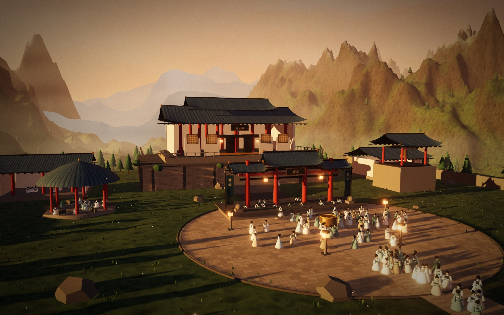
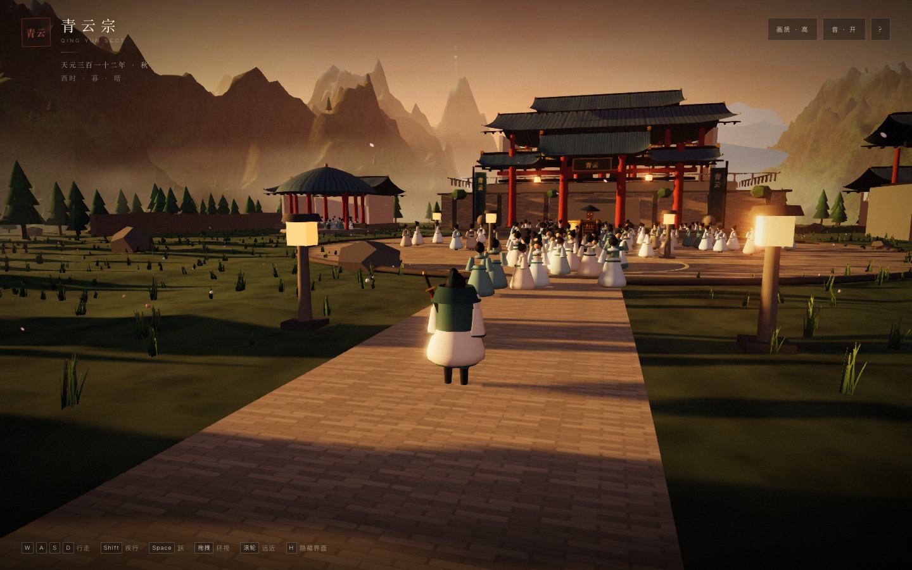
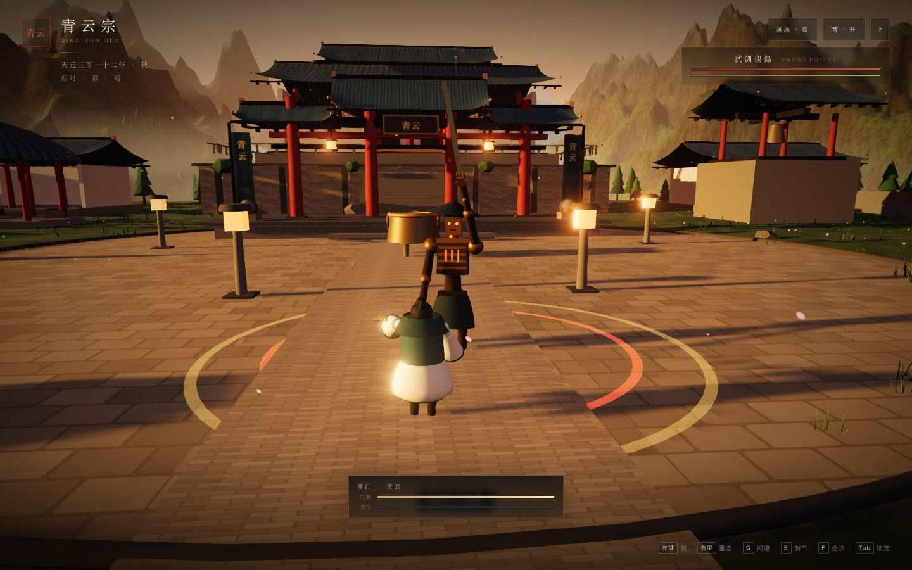
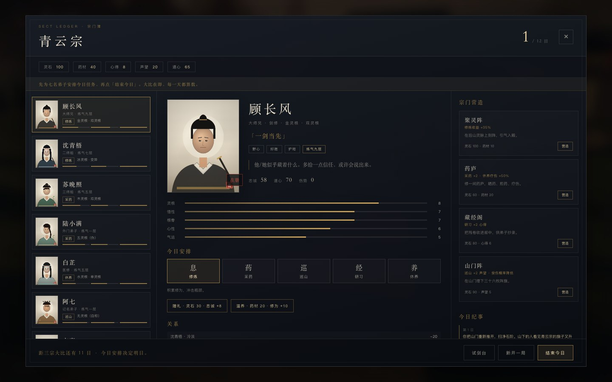
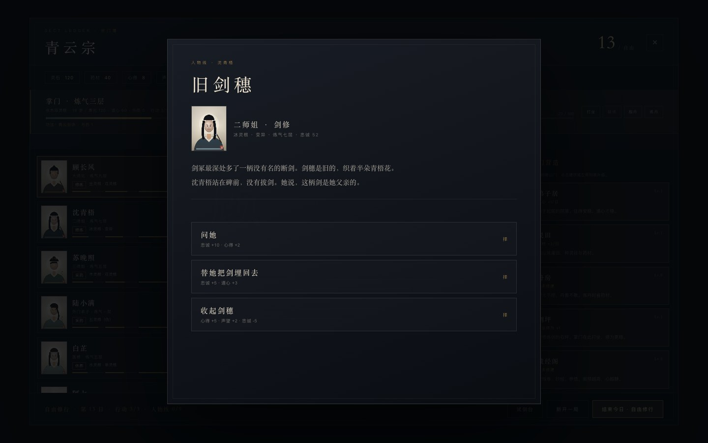
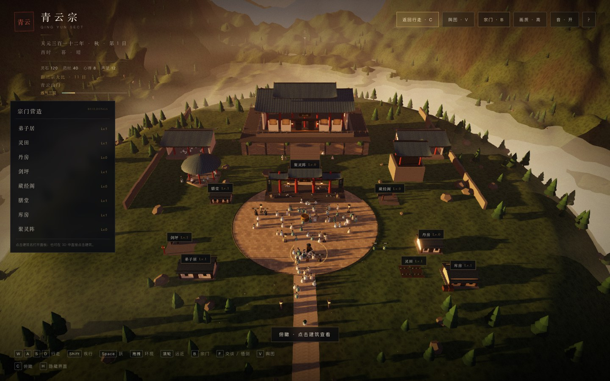
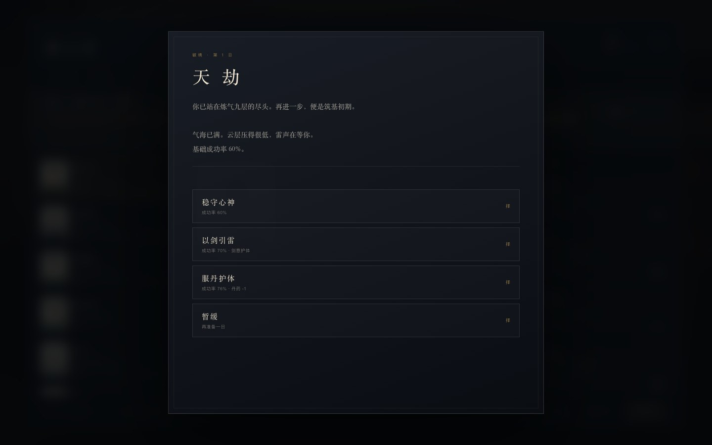
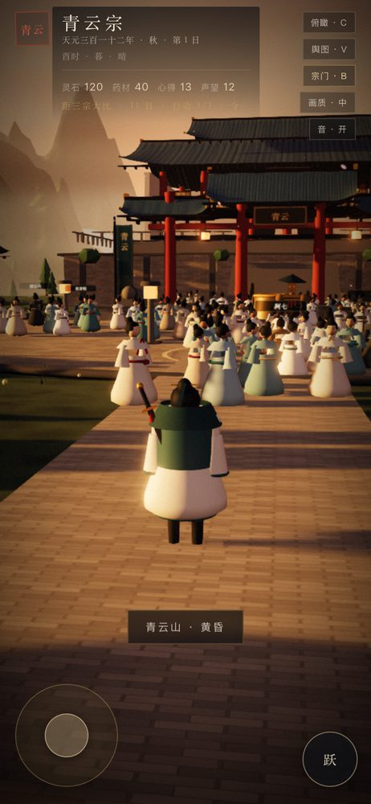
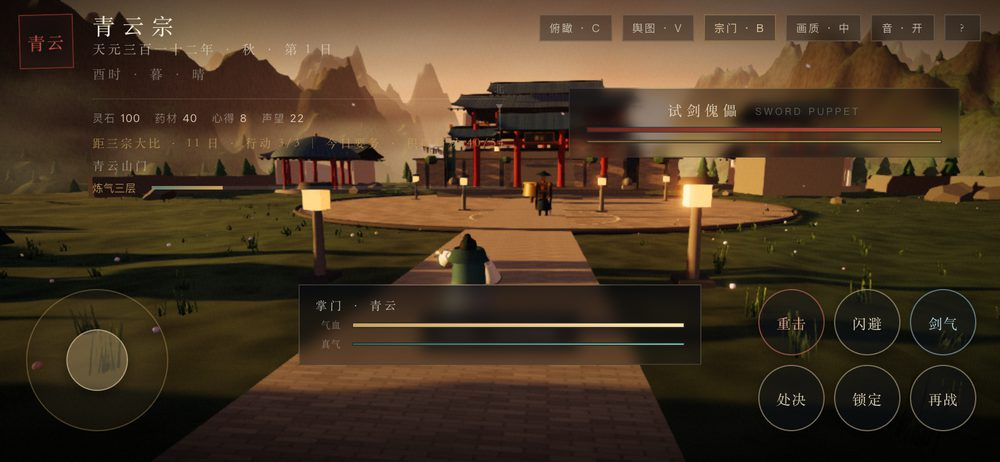
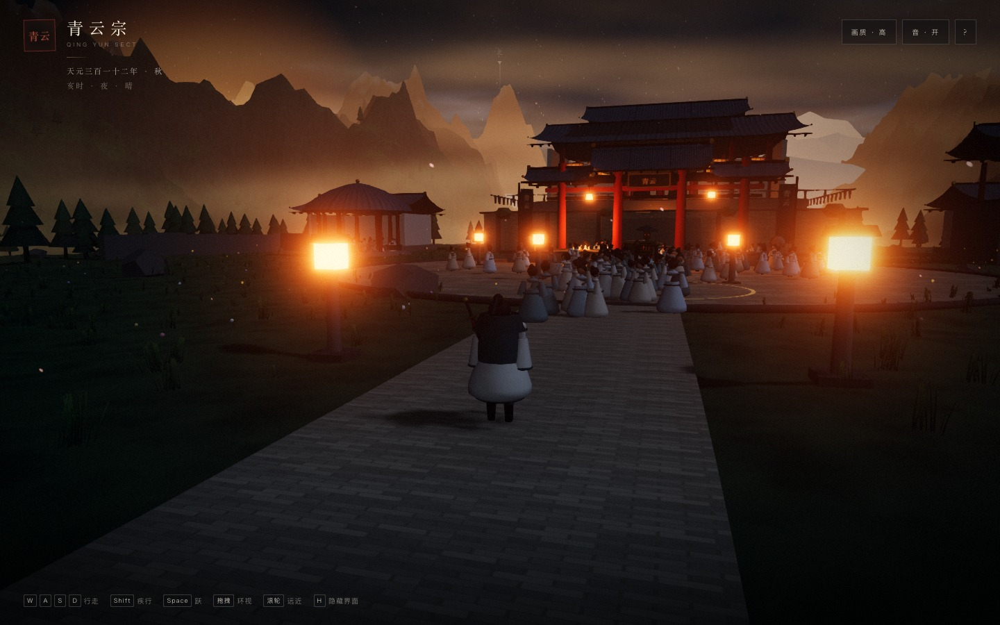

# 《仙宗》 · Immortal Sect

> ⚠️ **这是一个 Demo，不是正式发行的游戏。**
>
> 本仓库是我用 **DeepSeek API**（DeepSeek 大模型）一步一步驱动生成的 **纯 Web 技术演示**，用来验证「用 AI 从零写一个能跑的 3D 浏览器游戏」这件事到底能做到什么程度。它不是商业产品、没有正式美术/配音/服务器，数值与平衡也没有经过长期玩家调优——**请把它当成一个有玩法的技术原型，而不是一款成品游戏。**

<p align="center">
  
</p>

| 技术栈 | 说明 |
|---|---|
| 渲染 | three.js（WebGL2）+ TypeScript + Vite |
| 形态 | 纯前端单页，无后端、无账号、无联机；存档走 `localStorage` |
| 资产 | **全部程序化生成**——没有外部模型 / 贴图 / 音频文件 |
| 生成方式 | **DeepSeek API 对话式生成**：设计文档 → 代码 → 构建 → Playwright 冒烟回归 → 部署 |
| 回归 | 70 项 Playwright 自动化检查（桌面 + 手机 + 布局 + 旧档迁移） |

---

## 它是什么 / 不是什么

**是**
- 一座可以经营的山门：七名弟子、建筑升级、每日要务、宗门功阶。
- 一个可操作的主角：第三人称行走、斗法、破境、渡劫。
- 一条会推进的叙事：七条人物弧线（各 3 幕）、魔道反派主线、时代事件、多结局。
- 一次 AI 编码实验：从零到可部署，代码与文档全部由 DeepSeek 生成并在对话中迭代。

**不是**
- ❌ 不是商业游戏，**不售卖、不运营、无版号**；
- ❌ 没有正式美术资产（角色是低多边形程序化占位，界面是 CSS 手绘）；
- ❌ 没有配音与音乐（只有 WebAudio 程序化音效）；
- ❌ 没有服务器、联机、排行榜、付费系统；
- ❌ 数值没有经过真实玩家长期验证，**仅供演示**。

> 与 DeepSeek 官方无隶属关系；仅作为使用其 API 的个人 Demo 展示。

---

## 先看效果

| 探索 | 斗法 |
|---|---|
|  |  |

| 宗门簿 | 人物弧线 |
|---|---|
|  |  |

| 俯瞰山门 | 天劫 |
|---|---|
|  |  |

| 手机 · 竖屏 | 手机 · 战斗 |
|---|---|
|  |  |



---

## 快速开始

```bash
cd prototype
pnpm install
pnpm dev            # 开发服务器（默认 127.0.0.1:5178）

# 或跑已构建版本
pnpm build
node serve.mjs      # → http://127.0.0.1:4175

# 自动化回归（需先 build）
pnpm test:smoke     # 70 项
```

参数：`?demo=1` 跳过标题直接开局；`&intro=0&story=0` 跳过序章；`&fight=1` 直接进斗法；`&panel=1` 打开宗门簿；`&t=21` 设定起始时辰。

---

## 操作

**桌面**
- `WASD` 行走 · `Shift` 疾行 · `Space` 跃 · 拖拽环视 · 滚轮远近
- `B` 宗门簿 · `V` 舆图 · `C` 俯瞰 · `F` 交谈/场景交互 · `1-4` 晨/午/暮/夜 · `Esc` 暂停 · `F1` 性能
- 斗法：`左键` 三段剑 · `右键` 重击 · `Q` 闪避 · `E` 剑气 · `F` 处决 · `Tab` 锁定 · `R` 重开

**手机 / 平板**（页面会自动切换触屏界面）
- 左下 **虚拟摇杆** 行走（推满自动疾行）· 右半屏拖拽环视 · **双指捏合**缩放
- 「跃」键跳跃；靠近 NPC / 场景动作时自动出现 **上下文交互键**
- 斗法时右侧弹出 **3×2 技能网格**（重击 / 闪避 / 剑气 / 处决 / 锁定 / 再战），点屏幕轻击
- 竖屏会提示「横屏体验更佳」（可关闭）

> 触屏设备会自动把设备像素比上限压到 1.4、首次进入默认「中」画质，以保证帧率。
> 支持「添加到主屏幕」：装好后以独立窗口全屏运行（PWA manifest + 应用图标）。

---

## 玩法概览

| 模块 | 内容 |
|---|---|
| 世界 | 程序化山势、云海、雾、昼夜循环、四季轮转 |
| 经营 | 12 日章节 + 自由修行；8 栋建筑 × 3 级外观；弟子驻派与职业对口 |
| 策略 | 每日 3-4 张候选事件（含成功率判定）；每日要务（随周目/后期变陡）；宗门功业 → 七级宗阶 |
| 成长 | 掌门九境、破境、天劫化形 Boss 战；香火天梯（4 项永久增益切换） |
| 弟子 | 七人各有灵根/性格/秘密/关系；忠诚离心与寻回；功法研习（四路专精） |
| 叙事 | 七条人物弧线各 3 幕 + 魔道仇敌四幕主线 + 6 段时代事件 + 多结局群像 |
| 斗法 | 三段剑、重击、剑气、闪避、架势、处决、锁定、顿帧/震屏/刀光 |
| 收集 | 四件掌门法宝（试剑金令 / 破煞剑穗 / 圣地古印 / 灵脉之钥）、四季限量事件与天材地宝、二周目结转 |
| 外壳 | 标题、暂停、自动档 + 3 手动槽、导出/导入、画质三档、性能面板 |
| 完成度 | **23 项成就** · 首次引导 · 日期转场卡 · 自动存档回执 · 触屏震动 · 按压反馈 · 触感开关 |

---

## 文档

设计文档也在仓库里（`docs/`），它们记录的正是「AI 如何被组织起来做一个游戏」的过程。展开看：

<details>
<summary>点开文档索引（00–37）</summary>

| # | 文档 | 内容 |
|---|---|---|
| 00 | [愿景与约束](docs/00-vision.md) | 体验支柱、Web 上的可度量定义 |
| 01 | [玩法选型](docs/01-strategy-options.md) | 6 个方向评分矩阵 |
| 02 | [核心循环](docs/02-core-loop.md) | 三层时间尺度、玩家旅程 |
| 03 | [修炼](docs/03-cultivation.md) | 境界、功法、道心、天劫 |
| 04 | [宗门经营](docs/04-sect-sim.md) | 建筑、灵气、弟子、派系 |
| 05 | [世界模拟与 AI](docs/05-world-sim-ai.md) | Sim LOD、导演系统、预算 |
| 06 | [战斗](docs/06-combat.md) | 斗法、五行、打击感 |
| 07 | [技术架构](docs/07-tech.md) | 渲染管线、Worker、存档 |
| 08 | [美术与音频](docs/08-art.md) | 色彩脚本、LOD、廉价 3A 技巧 |
| 09 | [路线图与风险](docs/09-roadmap.md) | 里程碑、风险登记 |
| 10 | [参考拆解](docs/10-references.md) | 阅读清单（仅思路借鉴） |
| 11 | [质量基线](docs/11-quality-bar.md) | G1 验收与实测 |
| 12 | [斗法切片](docs/12-combat-slice.md) | 数值、AI 状态机、镜头 |
| 13 | [经营与第一章](docs/13-sect-management.md) | 弟子、事件、评分、结局 |
| 14 | [弟子入山门](docs/14-world-characters.md) | 3D 位置、交谈、心事 |
| 15 | [存档外壳](docs/15-save-load.md) | 标题/暂停、多槽、导入导出 |
| 16 | [山门之外](docs/16-regions.md) | 剑冢/药圃/坊市、舆图 |
| 17 | [掌门修炼](docs/17-cultivation.md) | 破境、天劫、寿元、道心 |
| 18-19 | [G4 策划](docs/18-g4-design.md) · [建筑与俯瞰](docs/19-buildings-and-overview.md) | 建筑实体、俯瞰、面板 |
| 20-23 | [自由修行](docs/20-free-mode.md) · [人物弧](docs/21-character-arcs.md) · [美术](docs/22-art-pass.md) · [性能](docs/23-performance-pass.md) | 行动点、三条弧、群像 LOD |
| 24-27 | [策略纵深](docs/24-strategy-depth-pass.md) · [可玩性](docs/25-playability-pass.md) · [进阶](docs/26-progression.md) · [收官](docs/27-completeness-pass.md) | 候选/风险、要务、宗阶、被动 |
| 28-30 | [二周目](docs/28-new-game-plus.md) · [天劫 Boss](docs/29-tribulation-boss.md) · [季节寿元](docs/30-seasons-lifespan.md) | 结转、雷劫傀儡、坐化结局 |
| 31-32 | [平衡预演](docs/31-balance-rehearsal.md) · [第二辑人物线](docs/32-character-arcs.md) | 自动预演、叙事谱 9→21 段 |
| 33-36 | [香火天梯](docs/33-faith-ladder.md) · [魔道主线](docs/34-demon-mainline.md) · [掌门法宝](docs/35-master-artifacts.md) · [功法研习](docs/36-technique-tree.md) | 功业兑换、反派弧、至宝、传法 |
| 37 | [手机端适配](docs/37-mobile-touch.md) | 虚拟摇杆、触屏交互、宗门簿重排 |
| 38 | [季限事件与难度曲线](docs/38-seasons-and-curve.md) | 四季限量事件、天材地宝、要务随周目变陡 |
| 39 | [成就与手感](docs/39-achievements-and-feel.md) | 23 项成就、触屏震动、按压反馈、设置项 |
| 40 | [引导与打磨](docs/40-onboarding-and-polish.md) | 首次引导、自动存档回执、标题进场、添加到主屏幕 |
| 41 | [旧存档迁移修复](docs/41-legacy-save-migration.md) | 线上 `undefined.length` 崩溃的根因与回归 |

</details>

---

## 已知限制（诚实清单）

1. **美术是占位**：角色为低多边形程序化模型，场景为程序化几何 + 手绘 CSS 界面，不是最终品质。
2. **没有音频内容**：仅程序化合成音效，无音乐、无配音。
3. **数值未长期调优**：平衡靠自动化预演调过，但没经过真实玩家长期验证。
4. **移动端为「可用」而非「精致」**：已修掉重叠、保护帧率，但复杂面板在窄屏仍是紧凑排版。
5. **AI 生成代码的代价**：部分模块存在历史遗留写法，文档也有前后迭代痕迹；以「能跑、可读、可回归」为准，不追求工程洁癖。
6. **无后端**：存档只在本地浏览器，换设备/清缓存会丢。

---

## 许可与第三方

- 本项目代码以 **MIT** 许可发布（见 [LICENSE](LICENSE)），可自由学习/修改/参考。
- 运行时依赖均为 MIT 开源库，版权归原作者：
  - [three.js](https://threejs.org/) — MIT · Copyright © 2010-2026 three.js authors
  - [simplex-noise](https://github.com/jwagner/simplex-noise) — MIT · Copyright (c) 2018 Jonas Wagner
- 其余为开发期工具（TypeScript / Vite / Playwright），不进入发布产物。
- 全部游戏代码、文案与美术（截图/图标）为本项目原创；`docs/10-references.md` 仅是设计思路的参考阅读清单，**不复制任何第三方素材或文本**。

---

> 仓库代号 `ImmortalSect`，作品名《仙宗》。本项目为 **DeepSeek API 驱动的演示 Demo**，与 DeepSeek 官方无隶属关系。
