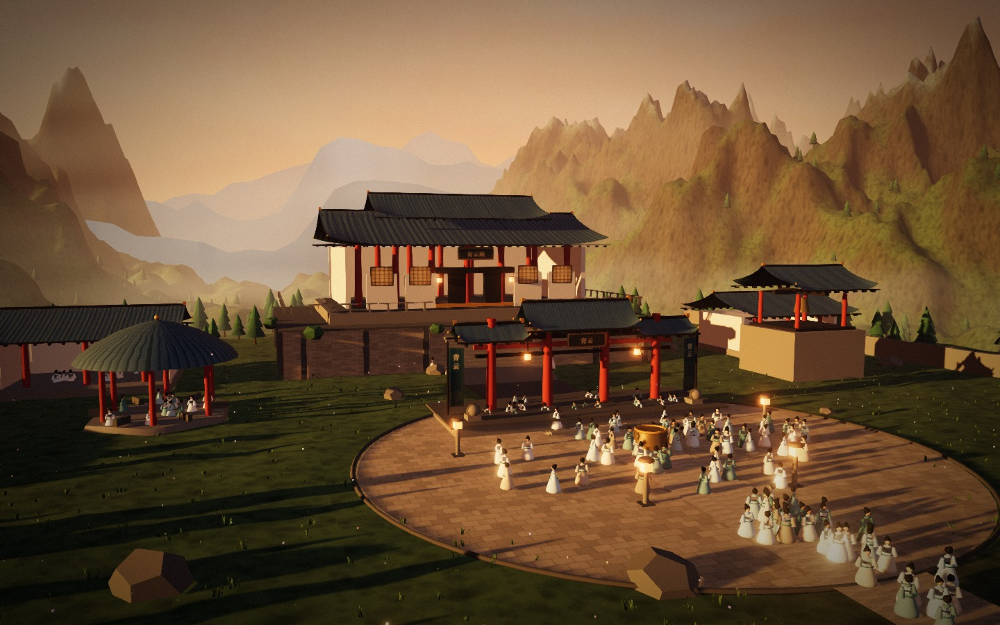
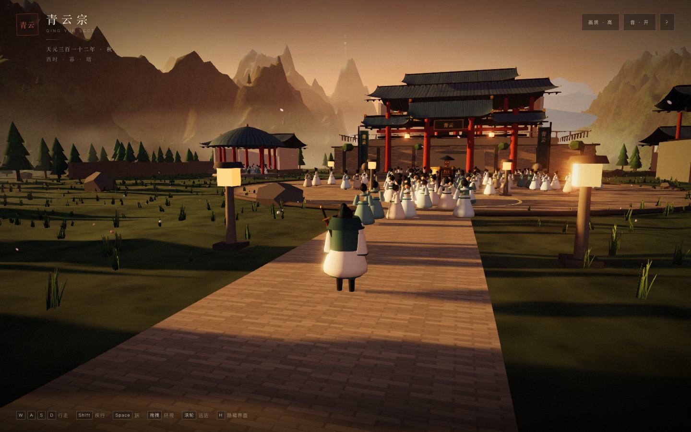
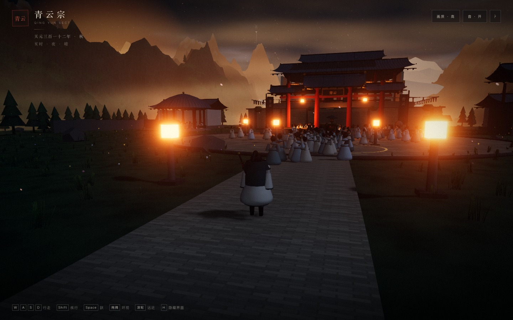
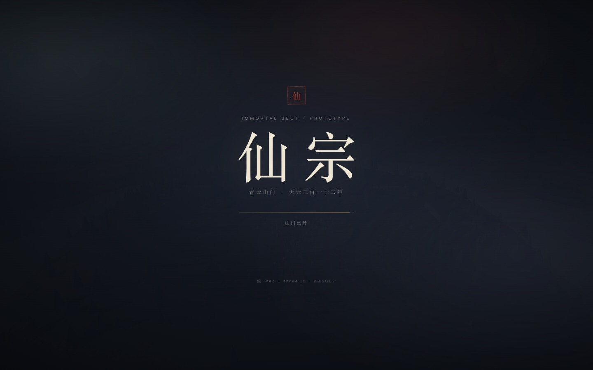

# 11 · 高质量基线（G1 验收）

> 「高质量」不是一句形容词，而是一组可以被检查、被测量、被复现的标准。
> 本文档定义《仙宗》的质量门槛，并诚实记录 G1 原型目前到了哪一步。

---

## 11.1 我们如何定义「高质量」

| 维度 | 含义 | 检查方式 |
|------|------|----------|
| **方向统一** | 色板、镜头、字体、UI、音频属于同一个世界 | 随机截一帧，能否认出是同一款游戏 |
| **性能可测** | 有预算、有面板、有降级路径 | 帧时间、draw calls、三角面、显存 |
| **交互可信** | 移动、镜头、碰撞、反馈「跟手」 | 连续操作 10 分钟不别扭 |
| **工程可维护** | 数据驱动、模块边界、可调试 | 新人 1 天能改一个系统 |
| **内容密度** | 每屏都有生活痕迹，不是空场景 | 截图里能否找到 5 个细节 |

> 3A 不是「多边形多」，而是这五项同时达到高水准，并且**没有短板**。

---

## 11.2 G1 已交付的内容

| 模块 | 内容 | 状态 |
|------|------|------|
| 世界 | 760m × 760m 程序化山门地形、山脊、云海、雾、日照 | ✅ |
| 建筑 | 山门、主殿（高台/台阶/栏杆）、六角亭、钟楼、侧殿、山墙 | ✅ |
| 角色 | 第三人称掌门（移动/疾行/跳跃/程序化步态） | ✅ |
| 群像 | 200 名弟子（4 个 InstancedMesh、分区游走、颜色变化） | ✅ |
| 时间 | 昼夜循环、黄昏/夜晚、灯笼与窗棂发光 | ✅ |
| 音频 | 程序化风声、钟声、混响（无音频文件） | ✅ |
| UI | 加载页、HUD、手册、画质切换、性能面板、提示 | ✅ |
| 渲染 | PBR、阴影、Bloom、FXAA、调色、暗角、颗粒 | ✅ |
| 工程 | Vite + TS strict、模块化、构建、静态预览 | ✅ |

### 截图

| | |
|---|---|
|  |  |
|  |  |

---

## 11.3 实测数据（2026-11-01）

环境：Apple M3 / Chrome headless / ANGLE Metal / 1920×1080 / 画质「高」。

| 指标 | 目标 | 实测 | 结论 |
|------|------|------|------|
| 同屏弟子 | 200 | 200 | ✅ |
| Draw calls | < 300 | **187** | ✅ |
| 三角面 | < 3.0 M | **0.79 M** | ✅ |
| 帧率（headless vsync） | 60 | 30（vsync 上限） | ⚠️ 需真实窗口复测 |
| 帧率（uncapped） | 60 | 44-58 | ⚠️ 接近，需优化 |
| 冷启动 | < 8 s | 12-15 s（含着色器预热） | ❌ 未达 |
| JS 体积 | < 1 MB | 659 KB（gzip 170 KB） | ✅ |
| 运行时错误 | 0 | 0 | ✅ |

> headless 环境的帧率与真实窗口差异很大；G1 的结论是「**规模与绘制预算成立**」，不是「60fps 已验收」。
> 冷启动主要耗在着色器编译；已把编译放在加载页内完成，避免首帧卡顿。

---

## 11.4 哪些是「占位」——必须诚实说明

| 项 | 现状 | 正式版目标 |
|----|------|------------|
| 角色模型 | 程序化基础体 + 布料色块 | 4-8 万面英雄模型、面部材质、4 套动画 |
| 建筑细节 | 体块 + 屋顶 + 栏杆 + 椽口 | 斗拱、瓦当、窗棂、匾额、陈设 |
| 植被 | 程序化松树/草/花 | 手工 LOD 资产 + 风场 + 季节变化 |
| 天空 | 渐变 + 程序云 | 体积云/大气散射 + 手工云图 |
| 音频 | 程序合成风声/钟声 | 古琴/箫/鼓分层音乐 + 环境音 |
| 战斗 | 未实现 | 实时 + 战术暂停、五行、阵法 |
| 经营 | 未实现 | 弟子/建筑/经济/外交/天劫 |
| 渲染后端 | WebGL2 | WebGPU 优先 + WebGL2 回退 |

> 这不是「3A 成品」，而是**能继续投资的技术与美术基线**。它证明了：浏览器里能放下这座山门、200 个人和这套镜头。

---

## 11.5 G2 质量闸门（必须全部通过）

### 美术

- [ ] 主角替换为正式模型（4-8 万面，含面部与 3 套服装）。
- [ ] 主殿/山门补齐斗拱、瓦当、窗棂、匾额、灯笼。
- [ ] 地图至少 3 个「值得截图」的机位。
- [ ] 统一 LUT，所有区域色温可区分。

### 性能

- [ ] 1080p / 目标机型 / 真实窗口：**≥ 60fps**，p95 帧时间 < 20ms。
- [ ] Draw calls < 250，三角面 < 2M。
- [ ] 冷启动 < 8s（含着色器预热）。
- [ ] 连续运行 30 分钟，堆增长 < 10%。

### 交互

- [ ] 8 方向移动、镜头碰撞、脚步/落地反馈。
- [ ] 攀爬/台阶/斜坡不卡住。
- [ ] 对话/事件可跳过、可回看。

### 内容

- [ ] 30-60 分钟垂直切片：1 座山门、7 个弟子、1 次天劫、1 场守山战。
- [ ] 至少 3 个「有意义的选择」被测试者记住。
- [ ] 70% 测试者愿意继续玩。

---

## 11.6 下一步优先级

1. **角色美术替换**（最高优先）：主角 + 3 个弟子变体，先把「人」做好。
2. **战斗原型**：1v1 斗法 + 五行 + 战术暂停。
3. **经营循环**：弟子派遣、建筑、日结算。
4. **天劫演出**：把「修炼」变成可玩的 Boss 战。
5. **音频/演出**：主题音乐、环境分层、过场镜头。

> 先补最短的板，而不是继续加系统。

---

## 11.7 G2 斗法切片补充验收（2026-11-01）

| 维度 | 结果 | 判定 |
|------|------|------|
| 玩法闭环 | 三段剑 / 重击 / 剑气 / 闪避 / 架势 / 处决 / 胜负 / 重开 | ✅ |
| 敌人可读性 | 红环 + 举剑双 telegraph；7 状态机 | ✅ |
| 镜头 | 锁定、越肩、注视点前移、3m 距离保持 | ✅ |
| 反馈 | 顿帧、震屏、刀光、火花、伤害数字、程序化音效 | ✅ |
| 稳定性 | 胜利/失败/重开/靠近触发/技能/重击/处决，0 错误 | ✅ |
| 性能 | 324 draw calls / 0.33 M 三角面（战斗） | ⚠️ 略高于 300 目标 |
| 美术 | 傀儡与主角仍为程序化占位；待机时剑被身体遮挡 | ❌ 未达正式标准 |

> 详见 [12-combat-slice.md](12-combat-slice.md)。下一步：格挡/弹反、敌人种类、Boss、正式角色模型。

## 11.8 G2 宗门章节补充验收（2026-11-02）

| 维度 | 结果 | 判定 |
|------|------|------|
| 角色 | 7 名弟子，独立灵根/五维/性格/心事/关系/立绘 | ✅ 章节级 |
| 策略 | 5 种安排、4 种营造、赠礼/温养、伤势/道心、付费选项门槛 | ✅ |
| 叙事 | 序章 + 6 主事件 + 5 个人事件 + 3 随机事件；选择改变关系/旗标/结局 | ✅ |
| 结局 | 三宗魁首 / 三甲 / 山门犹在 / 易主；七人后日谈 | ✅ |
| 存档 | 自动续档、刷新恢复、结局重开 | ✅ |
| 战斗联动 | 试剑胜利计入声望/灵石/评分 | ✅ |
| 稳定性 | 12 日全流程、分支、续档，0 控制台错误 | ✅ |
| 美术 | 立绘为程序化水墨；七名弟子已进入 3D，但无骨骼/口型/碰撞；建筑/角色仍占位 | ❌ 未达正式标准 |
| 体量 | 仅一章 12 天；无季节循环、天劫、宗门战 | ⚠️ 切片范围 |

> 详见 [13-sect-management.md](13-sect-management.md)。它已经是可以坐下玩完的一章，但仍不是完整商业版。

## 11.9 G2 3D 人物补充验收（2026-11-02）

| 维度 | 结果 | 判定 |
|------|------|------|
| 3D 存在 | 7 人独立网格/名札，按安排分布 5 个去处 | ✅ |
| 可发现性 | 3.6m 提示；宗门簿显示“今日去处” | ✅ |
| 交谈 | 立绘/身份/关系台词/四选项；每日每人一次、全宗门两次 | ✅ |
| 角色差异 | 三档问候 × 五种安排 × 剧情旗标；七套配饰/颜色 | ✅ |
| 心事 | 忠诚/旗标解锁，写入存档 | ✅ |
| 日程联动 | 改安排 → 位置同步；巡山行走 | ✅ |
| 战斗 | 七人退场/归位 | ✅ |
| 存档 | 交谈、心事、位置续档 | ✅ |
| 性能 | 开局广角 347 calls；隐藏七人 328（+19） | ⚠️ 仍高于 300 |
| 动画 | 无骨骼、手臂动作、口型、表情；无碰撞 | ❌ 未达正式标准 |

> 详见 [14-world-characters.md](14-world-characters.md)。下一步：骨骼动画、多轮对话、角色关系事件。

## 11.10 G3 游戏外壳验收（2026-11-02）

| 维度 | 结果 | 判定 |
|------|------|------|
| 标题/暂停 | 继续、新游戏、载入、设置、回标题 | ✅ |
| 存档槽 | 自动 + 3 手动；元数据；覆盖/删除 | ✅ |
| 载入同步 | 3D 区域、七人位置、宗门簿、HUD、境界 | ✅ |
| 导出/导入 | JSON 导出、文件导入 | ✅ |
| 旧档迁移 | v1 单档 → 自动档 | ✅ |
| 设置 | 画质/静音持久化 | ✅ |
| 数据完整性 | 玩家、区域、事件、弟子、修炼全量入档 | ✅ |

## 11.11 G3 场景验收（2026-11-02）

| 维度 | 结果 | 判定 |
|------|------|------|
| 舆图 | 4 区域、当前高亮、旅行 | ✅ |
| 剑冢 | 悟剑 + 功法「霜刃」 | ✅ |
| 药圃 | 采药 +18（药庐 +6） | ✅ |
| 坊市 | 买/卖/买丹/打听 | ✅ |
| 每日限制 | 每场景动作每日一次 | ✅ |
| 区域存档 | 刷新回到剑冢 | ✅ |
| 群像/具名 | 离开山门隐藏，返回恢复 | ✅ |
| 视觉 | 局部光、动作光柱、名札 | ✅ |
| 性能 | 场景 273-295 calls；山门 350 | ⚠️ 山门仍高 |

## 11.12 G3 掌门修炼验收（2026-11-02）

| 维度 | 结果 | 判定 |
|------|------|------|
| 修炼 | 打坐、炼丹、服丹 | ✅ |
| 瓶颈 | 100 修为进入瓶颈，需主动破境 | ✅ |
| 破境 | 三种方式、成功率、成功/失败后果 | ✅ |
| 天劫 | 筑基节点独立标题/寿元损失 | ✅ |
| 功法 | 青云剑诀 → 霜刃（影响破境） | ✅ 仅破境 |
| 寿元/道心 | 成功 +5 寿元；失败损道心/寿元 | ✅ |
| 故事联动 | 关键选择改变道心 | ✅ |
| 战斗整合 | 真气上限随境界提高 | ✅ |
| 季节/年龄 | 无 | ❌ |
| 天劫演出 | 文本判定，非 3D 战 | ❌ |

> 详见 [17-cultivation.md](17-cultivation.md)。

## G4 Phase B 验收

- 8 栋建筑全部在山门可见，可点击。
- 每栋 3 级外观，升级后重建。
- 俯瞰列表 + 3D 标记可用。
- 施工推进、每日产出、存档恢复。
- 镜头/碰撞达到可接受。
- 已知：建筑仍是程序化低多边形；极端贴墙相机会变墙特写。

## G4 P1 验收

- 结局可留在山门，不再硬结束。
- 行动点可见、可耗尽、结束今日恢复。
- 自由事件可抽取/选择/结算。
- 自由模式可存档/载入。
- 已知：只有 6 个自由事件，无季节/人物长链。

## G4 P2/P3 验收

- 9 幕人物线按顺序触发。
- 离开/留下/终章日志不同。
- 自由模式/行动点/建筑继续可用。
- 群像新增 trim/face，draw calls +2。
- 已知：无骨骼/布料/口型/配音。
