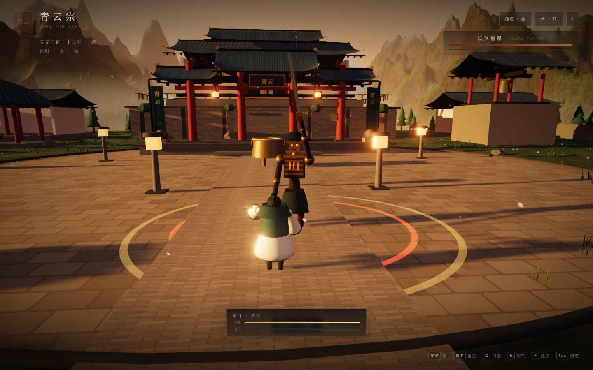
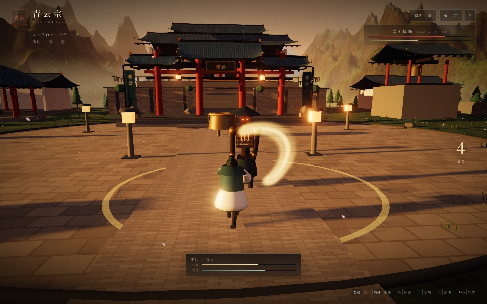

# 12 · 斗法切片（G2 第一步）

> **一个能打赢、能打输、能重开的 1v1 斗法闭环。**
> 它不是最终战斗系统，而是验证「镜头、手感、架势、反馈、HUD」是否能撑起《仙宗》的斗法。

| 试剑 | 重击 |
|---|---|
|  |  |

---

## 12.1 目标与范围

| 目标 | 验收 |
|------|------|
| 1v1 可玩 | 玩家能靠近试剑傀儡并完成一场战斗 |
| 有攻防节奏 | 三段剑、重击、闪避、剑气、架势、处决 |
| 镜头可信 | 锁定、越肩、距离保持、不穿模 |
| 反馈明确 | 顿帧、震屏、伤害数字、刀光、音效 |
| 能收尾 | 胜利/失败 banner、重置、再次挑战 |

**不在本切片内**：格挡/弹反、多敌人、Boss、门派战、装备与功法搭配。

---

## 12.2 玩法闭环

```
靠近试剑台（9.5m）
  → 自动锁定 · 弟子退开
  → 三段剑（左键）建立连击
  → 重击（右键）压架势
  → 剑气（E）远程收尾 / 打断
  → 闪避（Q）躲开红环重击
  → 架势破 → F 处决
  → 胜利「试剑 · 成」/ 失败「力竭」
  → 4 秒后收剑；R 再试一次
```

- 敌人被击败后不会立刻消失，而是跪倒；按 `R` 重置。
- 玩家死亡后回到山门起点，满状态，敌人复位。
- 离开试剑台 23m 自动脱战，敌人复位。

---

## 12.3 操作

| 输入 | 动作 |
|------|------|
| `WASD` | 移动（锁定后为环绕步） |
| `Shift` | 疾行 |
| `Space` | 跳跃 |
| 鼠标左键 | 三段剑（可预输入下一段） |
| 鼠标右键 | 重击（25 真气） |
| `Q` | 闪避（0.3s 无敌帧） |
| `E` | 剑气（30 真气，6s 冷却） |
| `F` | 处决（仅架势破时） |
| `Tab` | 锁定/解除锁定 |
| `R` | 胜利后重开 |
| `1–4` | 晨/午/暮/夜 |

---

## 12.4 数值骨架

### 玩家

| 项 | 值 |
|----|-----|
| 气血 | 120 |
| 真气 | 100（脱战 5/s，战斗中 7/s） |
| 三段剑伤害 | 44 / 52 / 72 |
| 三段剑削架势 | 12 / 14 / 18 |
| 重击伤害 | 122（削架势 36） |
| 剑气伤害 | 92（削架势 26） |
| 处决 | 9999（必杀） |
| 闪避无敌 | 0.3s |

### 试剑傀儡

| 项 | 值 |
|----|-----|
| 气血 | 900 |
| 架势 | 120（3 秒无受击后 7/s 回复） |
| 重击伤害 | 24 |
| 前摇 | 0.72s（红环 telegraph） |
| 攻击冷却 | 1.35s |
| 处决窗口 | 架势破后 2.2s |

**TTK**：约 25–35 秒；两轮连段 + 重击可破架势，处决收尾。

---

## 12.5 敌人 AI：可读的状态机

| 状态 | 行为 | 退出 |
|------|------|------|
| `dormant` | 垂首、眼睛微亮 | 玩家进入 9.5m |
| `chase` | 面向玩家、接近到 3.1m | 进入攻击距离 + 冷却结束 |
| `windup` | 举剑、地面红环扩张 | 0.72s 后 |
| `strike` | 挥剑，判定 3.8m / 正面 | 0.18s 后 |
| `recover` | 收招硬直 | 0.75s 后 |
| `stagger` | 单膝、可处决 | 2.2s 或被处决 |
| `dead` | 倒地 | 重开 |

- 每次重击前都有 **红环 + 举剑** 双 telegraph。
- 敌人不会连招，也不会读指令；目标不是「难」，是「读得懂」。

---

## 12.6 镜头

- **锁定**：相机自动对向敌人，越肩偏移 1.2m。
- **看向前方**：相机注视点比玩家胸口前移 1.9m，让玩家落在画面下三分之一、敌人居中。
- **距离保持**：玩家与敌人最小间距 3.0m；避免模型完全重叠。
- **震屏**：命中 0.18、重击 0.32、受击 0.5、处决 0.55。
- **脱锁**：`Tab` 后可自由环视，但本切片仍保持面向敌人。

---

## 12.7 反馈层

| 层 | 实现 |
|----|------|
| 顿帧 | 轻击 55ms / 重击 90ms / 处决 140ms |
| 刀光 | 月牙 Sprite（轻击白、重击金、剑气青） |
| 命中 | 火花粒子 + 冲击环 + 伤害数字 |
| 受击 | 红色闪屏 + 火星 + 震屏 |
| 音效 | 程序化挥剑、金属命中、闪避、受击、处决 |
| HUD | 敌方气血/架势、我方气血/真气、连击、处决提示 |

> 所有音效仍是 WebAudio 程序合成，没有音频文件。

---

## 12.8 实测与验收（2026-11-01）

| 项 | 结果 |
|----|------|
| 胜利流程 | ✅ 处决 → banner → 收剑 |
| 失败流程 | ✅ 死亡 → banner → 回山门 → 敌人复位 |
| 重开 | ✅ R 在 banner 内/结束后均可重开 |
| 靠近触发 | ✅ 9.5m 自动进入战斗，弟子隐藏 |
| 技能/重击 | ✅ 真气扣除、伤害与冷却正常 |
| 处决提示 | ✅ 架势破时 F 提示出现，处决必杀 |
| 控制台错误 | **0** |
| Draw calls（战斗） | **324**（弟子隐藏，傀儡 + VFX） |
| 三角面（战斗） | **0.33 M** |
| 1080p 帧率 | 171 fps（headless uncapped / M3；vsync 下 30） |
| 冷启动 | 11.3 s（含着色器预热） |

> 324 个 draw call 略高于「开局广角 347」中的近景预算；**已在 [docs/23](23-performance-pass.md) 合批到 257**（傀儡仅战斗时展开），低于 300 目标。
> headless 帧率不代表真实窗口，60fps 仍需目标机型复测。

---

## 12.9 已知限制

- 只有 1 个敌人、1 种武器、1 套连段。
- 没有格挡/弹反/受身；闪避是唯一防御。
- 没有敌人语音/音乐；音效为程序合成。
- 玩家与傀儡仍是程序化占位模型；剑在待机时会被身体遮挡。
- 没有装备、功法、五行克制；这些属于下一层系统。
- 战斗 HUD 尚未做手柄/移动端适配。

---

## 12.10 下一步

1. **格挡/弹反**：右键长按格挡，完美弹反破架势。
2. **敌人种类**：远程剑修、体修、召唤傀儡。
3. **Boss**：天劫雷兽 / 魔道长老，三阶段 + 场景机制。
4. **把斗法接进宗门战**：英雄单位 + 编队。
5. **角色替换**：正式模型与动画，优先解决「剑看不见」的问题。
