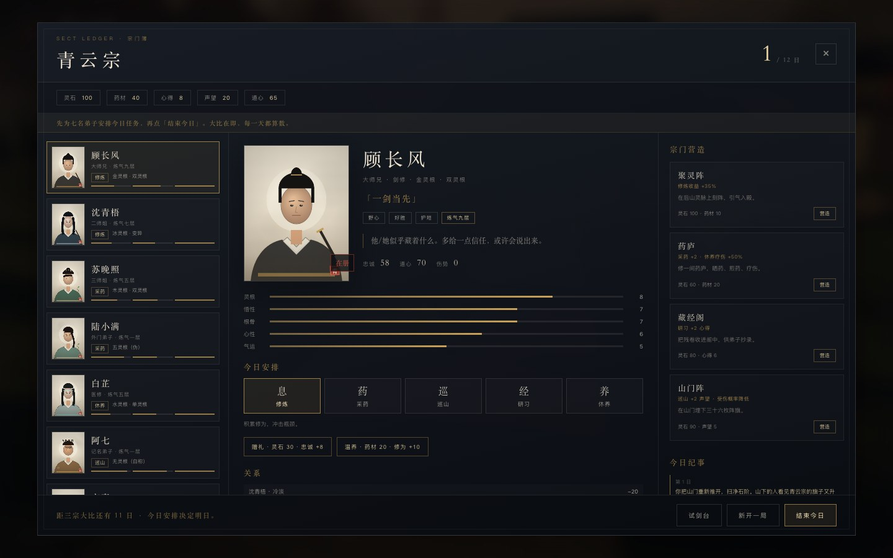
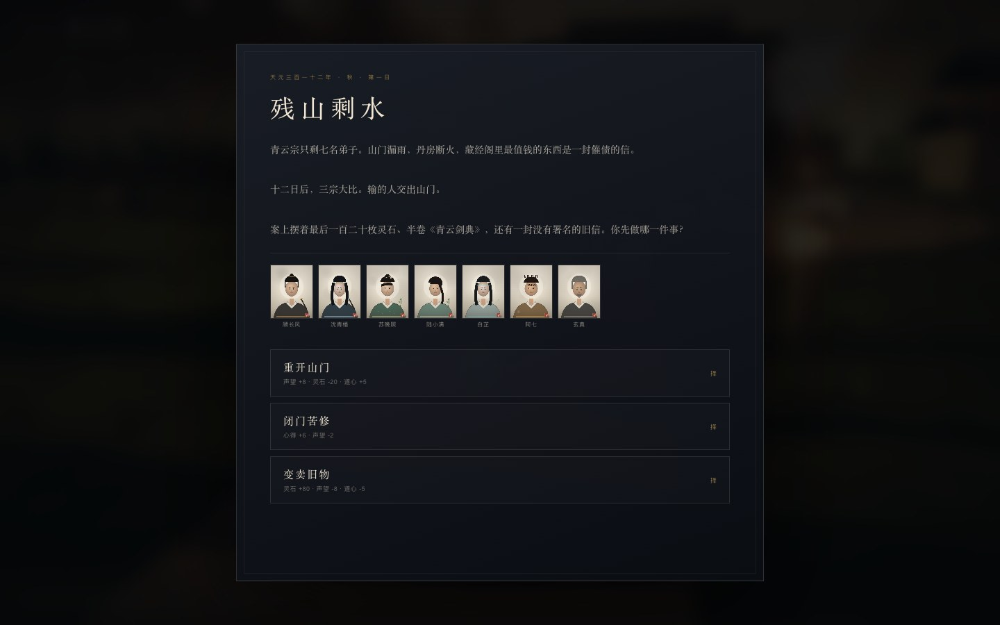
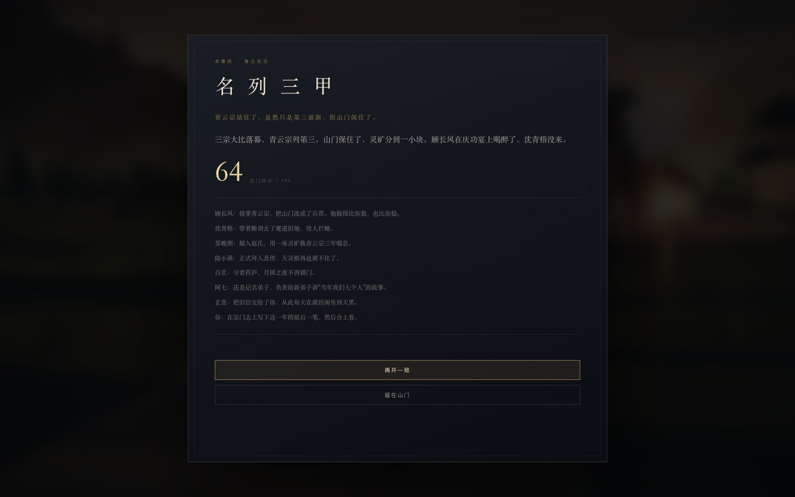
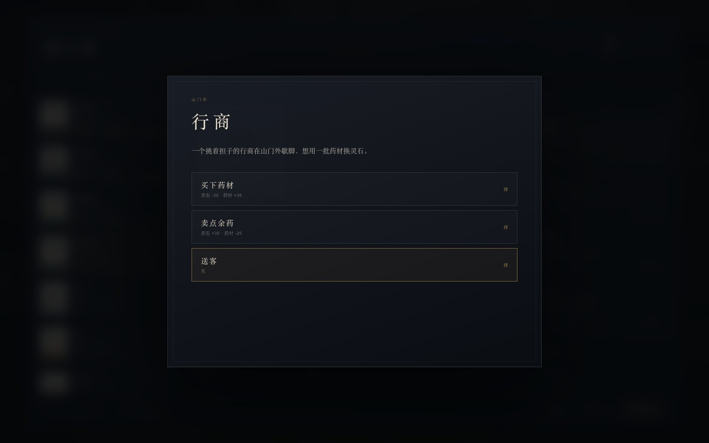

# 13 · 宗门经营与第一章（残山剩水）

> **十二天，七个人，一座漏雨的山门。**
> 这是《仙宗》第一个可完整通关的章节：安排弟子、经营山门、做选择、打试剑，最后站上三宗大比的云台。

| 宗门簿 | 序章 |
|---|---|
|  |  |

---

## 13.1 章节结构

```
第一日 · 残山剩水（序章选择）
  ↓
每日：安排七名弟子 → 结束今日 → 结算 → 事件 → 选择
  ↓
第三日 · 灵脉异动
第五日 · 药炉里的魔印（白芷）
第七日 · 大师兄的剑（顾长风）
第九日 · 一纸婚书（苏晚照）
第十一日 · 天灵根（陆小满）
  ↓
第十二日 · 三宗大比 → 结局
```

- 12 天，每天 1 个主事件或随机事件；个人事件由 **前一日安排** 触发。
- 可随时去试剑台打傀儡，胜利给声望、灵石与最终评分。
- 进度自动存入 `localStorage`；刷新可续，可随时「新开一局」。

---

## 13.2 七名弟子

| 弟子 | 身份 | 灵根 | 性格 | 心事 | 个人线 |
|------|------|------|------|------|--------|
| **顾长风** | 大师兄 · 剑修 | 金 · 双灵根 | 野心、好胜、护短 | 认为掌门太软，想接任 | 第七日逼宫；第十日破境 |
| **沈青梧** | 二师姐 · 剑修 | 冰 · 变异 | 孤僻、痴剑、复仇 | 魔道灭门遗孤，藏着血色令牌 | 第四日剑冢；第三日灵脉 |
| **苏晚照** | 三师姐 · 丹修 | 木 · 双灵根 | 仁善、多疑、持家 | 家族要用她换一座灵矿 | 第九日婚书 |
| **陆小满** | 外门弟子 · 杂役 | 五灵根（伪） | 勤奋、痴情、自卑 | 封印之下是一品天灵根 | 第二日崖边灵草；第十一日天灵根 |
| **白芷** | 医修 | 水 · 单灵根 | 仁善、寡言、秘密 | 曾是魔道药人 | 第五日药炉魔印 |
| **阿七** | 记名弟子 · 无灵根 | 无（自称） | 乐观、贪吃、气运 | 能看见灵气流向 | 第六日山门外的影子 |
| **玄真** | 执事长老 · 体修 | 土 · 单灵根 | 保守、忠义、固执 | 灭门夜看见不该看的东西 | 第八日旧信 |

### 关系起点

- 顾长风 ↔ 沈青梧：**-20**（同门，互相不服）
- 沈青梧 ↔ 白芷：**+30**（旧识）
- 陆小满 ↔ 阿七：**+40**（山门里唯一的玩伴）
- 苏晚照 ↔ 陆小满：**+25**（照看）
- 玄真 ↔ 顾长风：**-10**（看不惯他的野心）

关系会随 **共同任务** 上升，因 **竞争修炼** 下降。关系影响事件、结局与部分选项。

---

## 13.3 每日策略

### 五种安排

| 任务 | 产出 | 代价 | 适合 |
|------|------|------|------|
| **修炼** | 修为（可破境） | 道心 -1，占用一天 | 高灵根/高悟性 |
| **采药** | 药材 | 受伤概率，道心不变 | 高根骨/高气运 |
| **巡山** | 声望 | 受伤概率，道心 -2 | 高根骨，山门阵 |
| **研习** | 心得 | 无 | 高悟性，藏经阁 |
| **休养** | 疗伤、道心 +8 | 不产出 | 伤势 ≥ 70 强制 |

### 资源

| 资源 | 来源 | 用途 |
|------|------|------|
| 灵石 | 事件、试剑、变卖 | 建筑、赠礼（30/次） |
| 药材 | 采药、事件 | 温养（20/次，修为 +10）、药庐 |
| 心得 | 研习、事件 | 藏经阁 |
| 声望 | 巡山、事件、试剑 | 最终评分、事件 |
| 道心 | 休养、事件 | 产出系数、结局 |

### 宗门营造（一次性）

| 建筑 | 成本 | 效果 |
|------|------|------|
| 聚灵阵 | 灵石 100 · 药材 10 | 修炼 +35% |
| 药庐 | 灵石 60 · 药材 20 | 采药 +2，休养疗伤 +50% |
| 藏经阁 | 灵石 80 · 心得 6 | 研习 +2 心得 |
| 山门阵 | 灵石 90 · 声望 5 | 巡山 +2 声望，受伤率降低 |

> 开局只有 120 灵石。**不可能全建**，必须选路线：修炼流、声望流、还是稳守流。

### 人与人的投资

- **赠礼**：灵石 30 → 忠诚 +8（每人每日一次）。
- **温养**：药材 20 → 修为 +10、道心 +2（每人每日一次）。
- **秘密**：忠诚 ≥ 60 或对应剧情后解锁角色心事。

---

## 13.4 事件与选择（节选）

### 第三日 · 灵脉异动

| 选择 | 结果 |
|------|------|
| 让顾长风去 | 灵石 +40，顾 +8，沈 -6，灵脉被「吞」 |
| 让沈青梧封脉 | 心得 +5，沈 +8，顾 -5，灵脉封住 |
| 亲自下脉 | 心得 +3，道心 +5，带回旧剑匣 |

### 第五日 · 药炉里的魔印

信她 / 留下察看 / 逐出山门。白芷可能留下，也可能永远离开；她的去留改变结局与药庐。

### 第七日 · 大师兄的剑

让位 / 拒绝 / 夜谈。让位会让顾长风接掌，结局完全不同；拒绝可能让他离心。

### 第九日 · 一纸婚书

应下（灵石 +120，苏 -25）/ 退回（声望 -6、灵石 -30，苏 +20）/ 让她自决。

### 第十一日 · 天灵根

公开护她 / 压下消息 / 送去大宗。陆小满可能成为真传，也可能离开青云宗。

### 第十二日 · 三宗大比

亲自登台 / 派顾长风 / 弃权保山门。评分由十二日的积累与故事选择共同决定。

---

## 13.5 评分与结局

```
score = 境界 × 38% + 修为 × 20% + 声望 × 22% + 人心 × 20%
      + 试剑胜场 × 3（上限 9）
      + 故事旗标加成
```

| 结局 | 条件 | 基调 |
|------|------|------|
| **三宗魁首** | ≥ 76 | 青云宗站上云台之巅 |
| **名列三甲** | ≥ 62 | 山门保住，站稳脚跟 |
| **山门犹在** | ≥ 45 / 弃权 | 没赢，但人还在 |
| **山门易主** | < 45 | 旗子被摘下，众人流散 |

结局会为七名弟子分别写一段 **后日谈**，取决于忠诚、去留与关键旗标（如 `guLead`、`suMarried`、`luReveal`、`baiTrust`、`xuanTruth`）。



---

## 13.6 每日结算与事件



每日结算会逐条列出产出、受伤、顿悟与破境；随后进入当日事件。事件选项会直接标注可见代价，但**长期后果不总是明说**。

---

## 13.7 存档与重开

- 自动存档：每次安排、赠礼、温养、营造、事件选择、结束今日后写入 `localStorage`。
- 刷新页面自动续档；若章节已结束，直接打开结局。
- 「新开一局」清空存档并重新播放序章。
- 存档版本 `v1`，带基础字段迁移。

---

## 13.8 实测

| 项 | 结果 |
|----|------|
| 12 日全流程 | ✅ 序章 → 6 主事件 + 5 个人事件 → 大比 → 结局 |
| 结局 | ✅ 三宗魁首 / 三甲 / 山门犹在 / 易主 |
| 存档续档 | ✅ 刷新后回到第 2 日，进度、资源、安排保留 |
| 分支门槛 | ✅ 灵石/药材不足时付费选项禁用 |
| 试剑联动 | ✅ 试剑胜利 +1 胜场、声望 +4、灵石 +20 |
| 面板暂停 | ✅ 打开宗门簿时时间与角色冻结 |
| 控制台错误 | 0 |

> 首轮平衡：全选「善意/第一项」路线约 64 分（三甲）；想拿魁首需要试剑、营造与更好的取舍。

---

## 13.9 已知限制

- 立绘为程序化水墨肖像，角色辨识度仍有限。
- 经营为 2D 面板；七名弟子已进入 3D 山门，但目前只有简单几何体、待机/行走与交谈，没有骨骼动画、口型与碰撞。
- 只有一章、12 天；没有季节/多年循环。
- 数值为第一版，资源在后期可能偏富余。
- 事件文本为单章体量，尚未做大规模分支。

> 但这些已经构成一个**可以坐下来玩完的章节**：有角色、有取舍、有后果、有结局。
