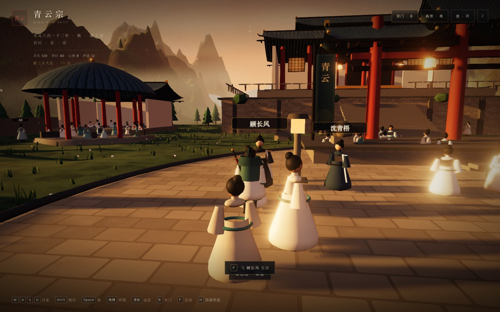
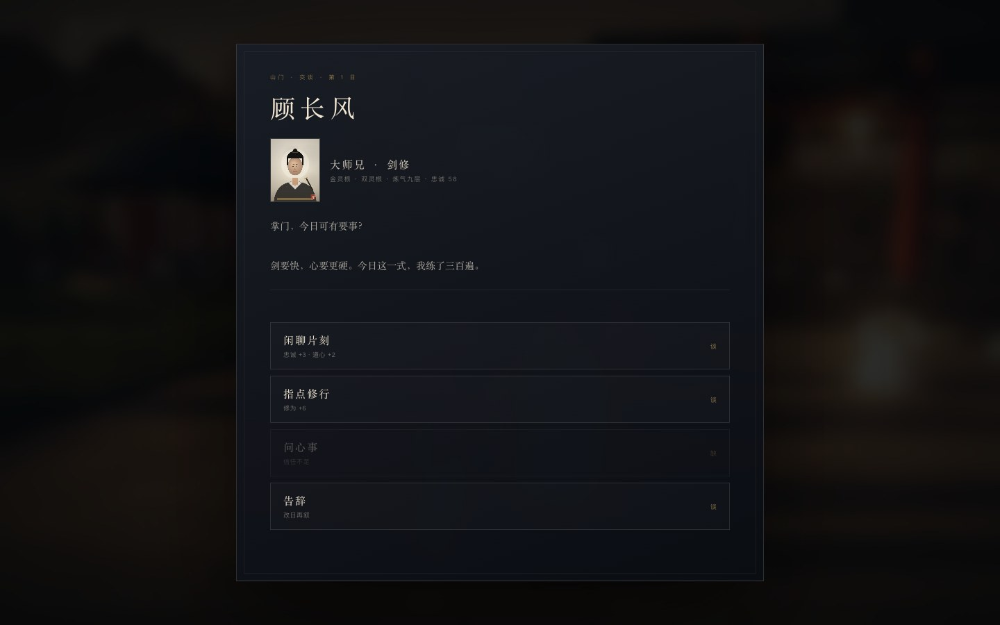
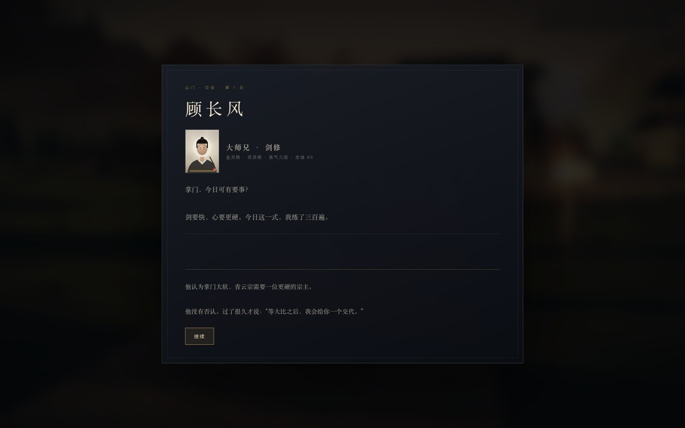

# 14 · 七名弟子进入山门

> 上一章里，七个人只活在宗门簿上。
> 这一章，他们站在山门里，有名字、有去处、有话说。

| 山门里的七个人 | 交谈 |
|---|---|
|  |  |

---

## 14.1 他们在哪里

每个弟子按 **今日安排** 出现在山门的不同位置：

| 安排 | 去处 | 行为 |
|------|------|------|
| 修炼 | 剑坪西侧 | 站立、轻微摇晃、面向靠近的玩家 |
| 采药 | 山门东侧药圃 | 站立、挎药篮 |
| 巡山 | 山门石阶 | 沿四个路点缓慢巡逻 |
| 研习 | 东侧殿前 | 站立、轻微前倾 |
| 休养 | 西侧亭 | 站立、面向亭子 |

- 每人有独立模型颜色、比例、配饰：
  - 顾长风 / 沈青梧：剑。
  - 苏晚照 / 陆小满：药篮。
  - 白芷：药箱。
  - 玄真：木杖。
  - 阿七：葫芦。
- 头顶有 **水墨名札**（Sprite），远近可读。
- 改动安排后，宗门簿里一改，山门里的位置同步。
- 战斗开始时七人退场；战斗结束回到原位。

> 在宗门簿的“今日安排”下方会显示 **今日去处**，方便在山门里找到人。

---

## 14.2 走过去，按 F

- 靠近到 **3.6m** 内，屏幕底部出现：

```
F  与 顾长风 交谈
```

- 按 `F` 打开交谈卡：立绘、身份、灵根、境界、忠诚、当前台词、四个选项。
- 交谈时 3D 世界暂停，关闭后恢复。
- 每人 **每日一次**；全宗门 **每日最多两次** 有收益的交谈。时间有限，先找谁，是策略。

---

## 14.3 四种交谈

| 选项 | 效果 | 说明 |
|------|------|------|
| **闲聊片刻** | 忠诚 +3 · 道心 +2 | 最稳，适合拉近关系 |
| **指点修行** | 修为 +6 | 适合冲境界 |
| **问心事** | 心得 +2 · 忠诚 +4 | 需忠诚 ≥ 60 或对应剧情旗标 |
| **告辞** | 无 | 不消耗次数 |

- “问心事”会揭示角色秘密，并写入 `heart_<id>` 旗标；之后宗门簿也会显示。
- 每日结束，`talked` 清空。
- 交谈状态随存档保存。

### 台词不是随机的

台词由三部分组成：

1. **关系问候**：低 / 中 / 高忠诚，三档不同。
2. **当前安排**：修炼、采药、巡山、研习、休养，各有不同的一句话。
3. **剧情旗标**：如 `guLead`、`baiTrust`、`xuanTruth`、`suFree`、`luReveal` 会追加一句。

例如顾长风：

- 低忠诚：“掌门。”
- 中忠诚：“掌门，今日可有要事？”
- 高忠诚：“你来了。剑坪的风，正好。”
- 修炼中：“剑要快，心要更硬。今日这一式，我练了三百遍。”
- 若已让位：“宗主印在你手里。你打算什么时候用？”

---

## 14.4 秘密与心事

七个人的秘密仍然只在 **忠诚 ≥ 60** 或对应剧情后可见：

- 顾长风：想接任宗主。
- 沈青梧：魔道灭门遗孤。
- 苏晚照：家族用她换灵矿。
- 陆小满：封印下的天灵根。
- 白芷：曾是魔道药人。
- 阿七：能看见灵气流向。
- 玄真：灭门夜看见正道上山。

“问心事”不是免费的信息：它会消耗当日交谈次数，也可能改变你对某个人物的判断。



---

## 14.5 技术实现

```
src/characters/named.ts
  ├─ 7 个独立 Group
  ├─ 每人 1 个合并网格（robe/lower/head/hair + 配饰，vertex colors）
  ├─ 每人 1 个名字 Sprite
  ├─ 任务点 + 角色偏移，避免重叠
  ├─ 巡山四路点
  ├─ 靠近时转向玩家
  └─ nearest() / setVisible() / sync() / debugState()
```

- **合并**：每个弟子 4 个身体部件 + 配饰合并为 **1 个 draw call**，材质共享。
- **名札**：Canvas 生成 256×64 纹理，Sprite 始终朝向相机。
- **同步**：宗门簿改动 → `named.sync(disciples)` → 位置/可见性更新。
- **战斗**：`combat` 的可见性回调同时隐藏群像与七名弟子。

---

## 14.6 实测

| 项 | 结果 |
|----|------|
| 七人位置 | ✅ 两两不重叠，按安排分布 |
| 名札 | ✅ 七人可读 |
| 靠近提示 | ✅ 3.6m 内显示姓名 |
| `F` 交谈 | ✅ 标题/立绘/身份/台词/四选项 |
| 闲聊 | ✅ 顾长风忠诚 58 → 61 |
| 问心事 | ✅ 忠诚 65 时解锁；心得 +2、旗标写入 |
| 每日两次 | ✅ 第三人显示“今日已叙两人”，收益被拒 |
| 安排同步 | ✅ 顾长风改研习后移动到东侧殿前 |
| 战斗退场 | ✅ 七人全部隐藏，战斗结束恢复 |
| 存档 | ✅ 交谈状态、心事旗标、安排位置随档恢复 |
| 12 日章节 | ✅ 仍可通关（三甲 64 分） |
| 控制台错误 | 0 |

### 性能

| 视角 | Draw calls | 三角面 |
|------|-----------|--------|
| 开局广角（含七人） | **347** | 0.82 M |
| 同视角隐藏七人 | 328 | — |
| 增量 | **+19** | — |

> 7 个身体 + 7 个名札 + 阴影，约 +19 calls。数值仍高于 300 目标，但增量可控。

---

## 14.7 已知限制

- 七人是 **简单几何体**：没有骨骼、手臂动作、口型、表情。
- 没有碰撞体，玩家可以从他们身上穿过。
- 名札始终显示，远距离会略密。
- 对话是 **线性文本 + 四个动作**，没有多轮分支。
- 七人不会主动找玩家，也不会互相交谈。
- 立绘仍是程序化水墨。

> 这一步解决的是“他们在不在山门里、能不能被找到、有没有话说”。
> 下一步才是“他们会不会动、会不会记住你、会不会彼此发生关系”。
