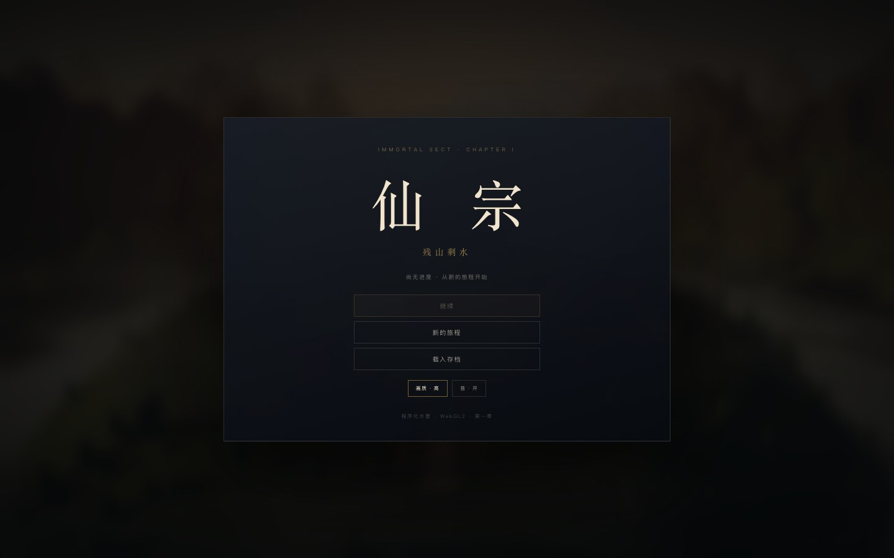
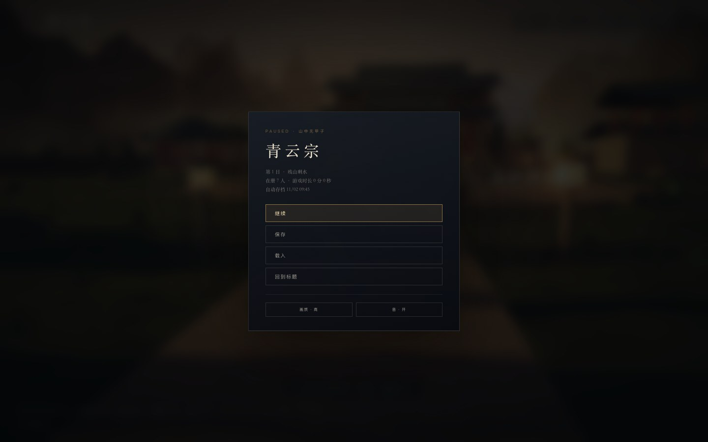
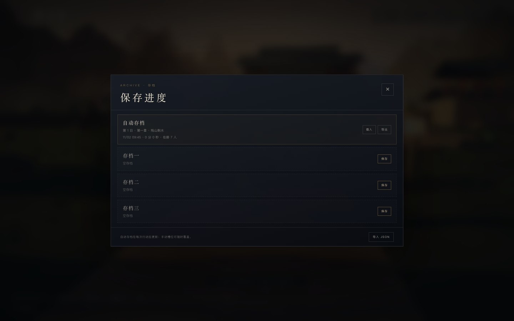

# 15 · 常规游戏外壳：保存 / 载入 / 标题 / 暂停

> 之前只有一个自动存档。现在它像一个正常游戏：标题、暂停、自动档、三个手动档、元数据、导出与导入。

| 标题 | 暂停 |
|---|---|
|  |  |

---

## 15.1 为什么先做这个

场景越多、修炼越深，丢档的代价越大。P0 先解决：

- 不能选手动档；
- 不能从暂停回滚；
- 不能导出备份；
- 不能保留设置；
- 标题/暂停/设置都没有。

---

## 15.2 存档结构

```ts
SaveMeta {
  slot: 'auto' | '1' | '2' | '3'
  day: number
  chapter: string
  updatedAt: number
  playSeconds: number
  active: number
  ending: string | null
  state: GameState
}
```

- localStorage key：`immortal-sect-saves-v2`
- 自动档：每次安排、交谈、修炼、事件、旅行、结束今日后更新。
- 三个手动档：随时保存、覆盖、删除。
- “继续”读取 **updatedAt 最新** 的档（自动或手动）。
- 旧版 `immortal-sect-save-v1` 会在首次启动时迁入自动档；旧档不删除。

---

## 15.3 标题菜单


- **继续**：有有效进度时可用；无进度时置灰。
- **新的旅程**：重开一局；自动档会更新，手动档保留。
- **载入存档**：打开存档列表。
- **画质 / 音**：即时切换并写入设置。

> “有效进度”判定：第 2 日以后、已看序章、或已通关；避免把首次自动生成的空白档当成可继续进度。

---

## 15.4 暂停菜单

游戏中按 `Esc`：

- 继续
- 保存 → 三个手动槽
- 载入 → 自动档 + 三个手动槽
- 回到标题（重新加载页面，自动档已保存）
- 画质 / 音

打开暂停会 **冻结时间、角色、战斗与宗门簿**。

> 斗法中不能暂停；斗法结束后再按 `Esc`。

---

## 15.5 存档列表



每行显示：

- 槽位名（自动存档 / 存档一 / 二 / 三）
- 第几日、章节名、是否通关
- 保存时间
- 游戏时长
- 在册弟子数
- 载入 / 导出 / 删除

操作：

- **保存**：手动槽可新建或覆盖（覆盖需确认）。
- **载入**：从标题或暂停读取；会同步 3D 位置、宗门簿、HUD、弟子状态。
- **删除**：仅手动槽。
- **导出**：下载单个槽的 JSON。
- **导入 JSON**：文件选择，写入对应槽位。

---

## 15.6 载入后的状态同步

从暂停载入时，不只是换一份数据：

1. `game.loadSlot(slot)` 恢复状态。
2. 恢复玩家真气上限。
3. 传送到存档区域（第 15 节 P1 的场景）。
4. `named.sync()` 重建七名弟子位置。
5. 关闭暂停/剧情/宗门簿。
6. 重开宗门簿或对应剧情（序章、待处理事件、结局）。
7. 同步 HUD、时辰、区域名、掌门境界。

---

## 15.7 设置持久化

- 画质：高 / 中 / 低
- 静音：开 / 关
- 设置写入同一个 `saves-v2` 文件。
- 启动时读取并应用：
  - 画质在进入世界前应用；
  - 静音在 `AudioContext` 创建前设置，避免先响一声。

---

## 15.8 实测

| 项 | 结果 |
|----|------|
| 标题继续/新游戏 | ✅ |
| 暂停/保存/载入 | ✅ |
| 自动档更新 | ✅ |
| 三手动槽 | ✅ 覆盖确认、删除 |
| 载入同步 3D/宗门簿 | ✅ |
| 导出 JSON | ✅ 7353 字节示例 |
| 导入 JSON | ✅ 写回槽位 |
| 设置持久化 | ✅ 刷新后画质/静音保留 |
| 旧档迁移 | ✅ v1 第 4 日迁入自动档 |
| 控制台错误 | 0 |

---

## 15.9 已知限制

- 没有云端存档；只在本机 `localStorage`。
- 没有存档截图缩略图。
- 导入只接受本游戏 JSON；没有签名/校验和。
- 载入后玩家回到区域出生点，而不是精确坐标。
- 游戏时长按未暂停时间累计，切后台可能少算。
- 没有“自动档单独备份/回滚到上一自动档”。
