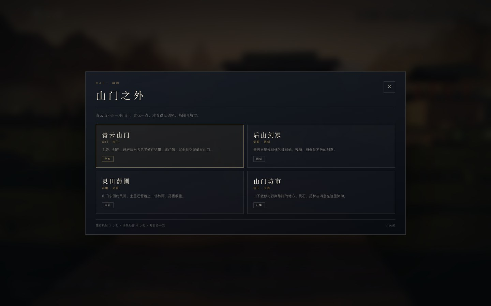
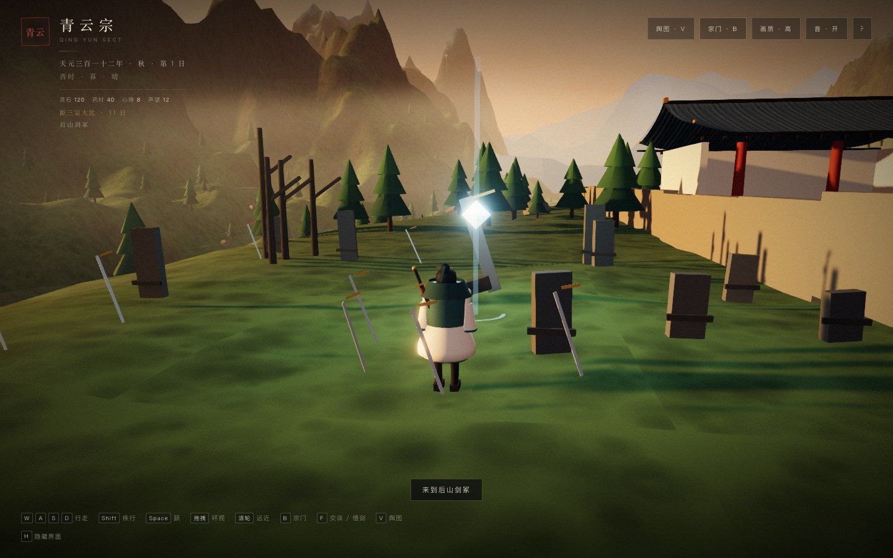
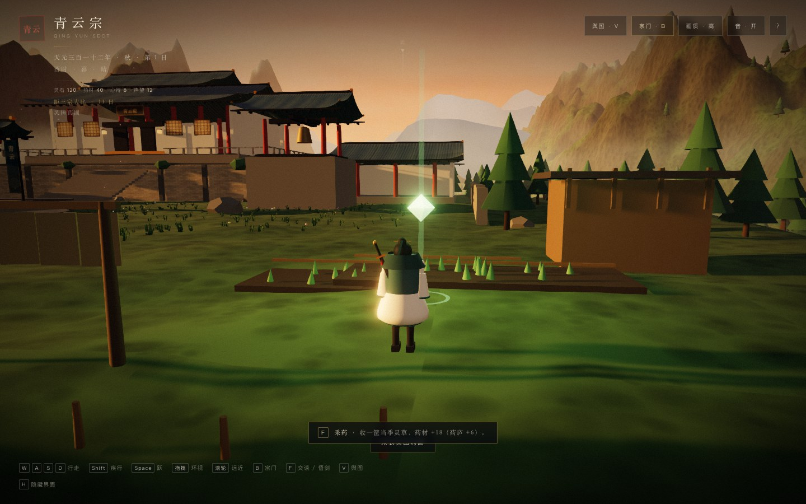
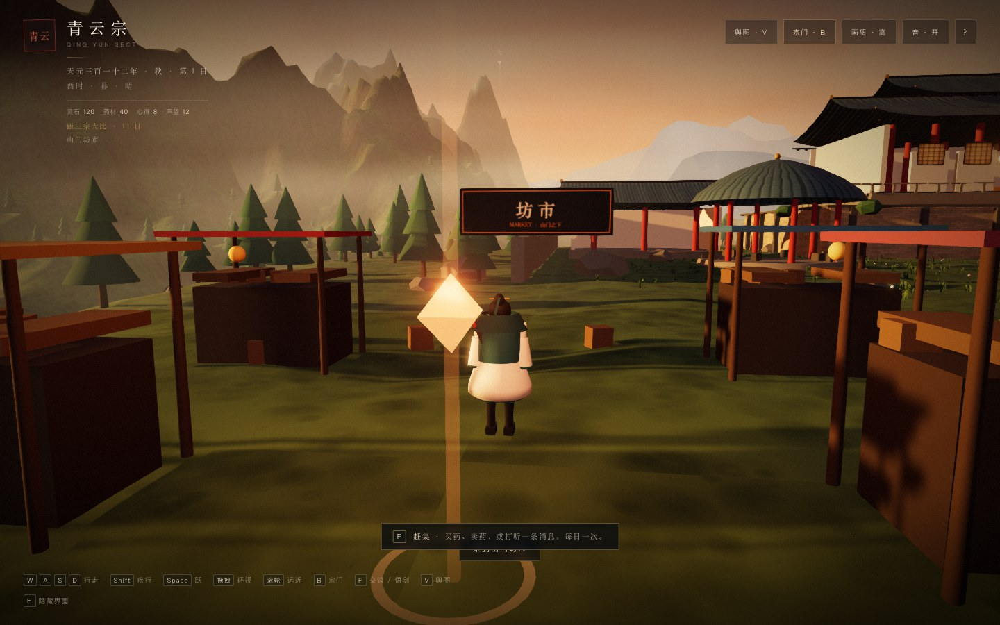

# 16 · 山门之外：剑冢、药圃、坊市

> 一座山门不再装下整个游戏。按 `V` 打开舆图，去三个“口袋场景”，每个场景有一个别处没有的动词。

---

## 16.1 场景表

| 场景 | 唯一动作 | 基础收益 | 每日 |
|------|----------|----------|------|
| **青云山门** | 宗门簿 / 试剑 / 交谈 | 经营与人物 | — |
| **后山剑冢** | 悟剑 | 心得 +4 · 修为 +6 · 习得「霜刃」；耗时 4 小时 | 1 次 |
| **灵田药圃** | 采药 | 药材 +18（药庐 +6） | 1 次 |
| **山门坊市** | 赶集 | 买药 / 卖药 / 买丹 / 打听 | 1 次 |

- 旅行约 **2 小时**；场景动作约 **4 小时**。时间成本已接入，但还没有日期推进/体力系统。
- `V` 开/关舆图；点击卡片旅行，当前所在地不可再点。
- 场景动作 `F` 交互；每日一次；结束今日重置。
- 区域进入存档；刷新/载入后回到该区域出生点。

---

## 16.2 后山剑冢

- 位置：山门西南的缓坡，避开侧殿与主殿。
- 内容：断碑、插地断剑、枯树、中央断剑、蓝色剑意光柱。
- 动作 **悟剑**：
  - 心得 +4；
  - 修为 +6；
  - 首次习得功法「霜刃」；
  - 可把气海推到瓶颈。
- 局部冷色点光 + 环境光，让剑冢在暮色里仍可读。

> 这是沈青梧线的空间锚点；后续可在这里放她的个人事件。

---

## 16.3 灵田药圃

- 位置：山门东侧，主殿侧前方。
- 内容：三块药田、灵草、药庐、晾药架、药篮。
- 动作 **采药**：药材 +18；已建药庐 +6。
- 与宗门簿的“采药”任务形成两条线：
  - 派弟子采药：消耗一天，可能受伤；
  - 自己去药圃：即时、稳定、每日一次。

---

## 16.4 山门坊市

- 位置：山门西侧，摊棚、酒旗、货箱、坊市牌。
- `F` 赶集打开交易卡：
  - **买入药材**：灵石 -25 → 药材 +30
  - **卖出药材**：药材 -20 → 灵石 +30
  - **买温养丹**：灵石 -30 → 丹药 +1
  - **打听消息**：声望 +3
  - **离开**
- 每日只能赶集一次；选择买、卖或打听，是资源路线取舍。

---

## 16.5 场景与山门的关系

- 三个场景都在同一张山下地图，只是不同坐标；没有加载画面。
- 离开山门时：
  - 200 群像弟子隐藏；
  - 七名具名弟子隐藏；
  - 只保留当前场景的道具与局部光。
- 回到山门：
  - 群像与七名弟子恢复；
  - 他们的位置按宗门簿安排。
- 场景道具按颜色合批；当前场景 draw calls 约 273-295，山门约 350。

---

## 16.6 实测

| 项 | 结果 |
|----|------|
| 舆图 | ✅ 4 个区域，当前高亮 |
| 旅行 | ✅ 传送、区域名、HUD 同步 |
| 剑冢 | ✅ 悟剑 +4 心得 +6 修为 +霜刃 |
| 药圃 | ✅ 采药 +18 药材 |
| 坊市 | ✅ 买/卖/买丹/打听，每日一次 |
| 每日限制 | ✅ 第二日重置 |
| 群像/具名隐藏 | ✅ 离开山门后 0 人可见，返回恢复 |
| 区域存档 | ✅ 载入后回到剑冢 |
| 性能 | ✅ 山门 ~350，场景 ~273-295 calls |
| 控制台错误 | 0 |

---

## 16.7 已知限制

- 场景是同一地形上的“口袋区域”，不是独立关卡/室内。
- 旅行 2 小时、动作 4 小时，但没有日期推进/体力/夜宿系统。
- 每个场景只有一个主要交互，内容量还小。
- 没有区域随机事件、天气、昼夜独立光照。
- 没有场景 NPC（除七名弟子在山门）。
- 场景边界靠坐标与视觉，不是硬墙。
