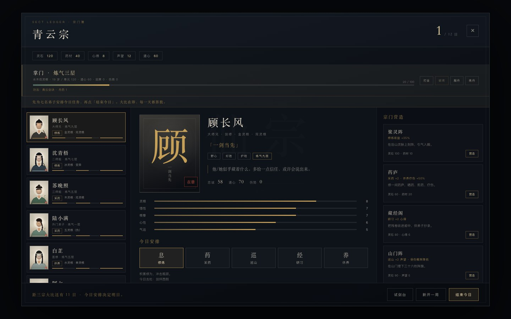
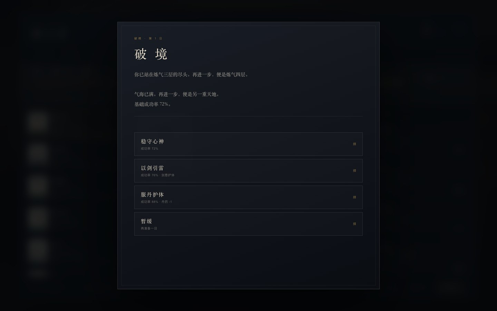
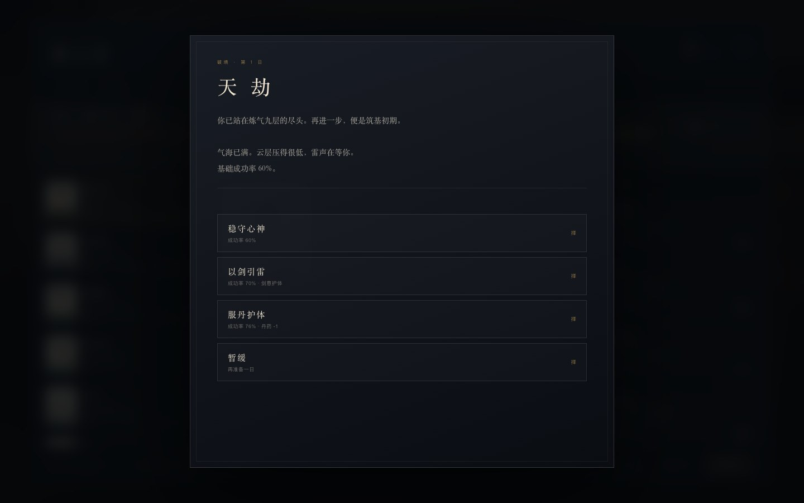
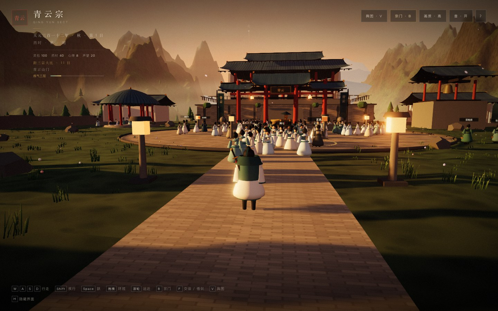

# 17 · 掌门修炼：境界、瓶颈、天劫

> 弟子有境界，掌门终于也有。打坐、服丹、悟剑，把修为推到瓶颈；再选择怎么破境。

| 掌门 | 破境 |
|---|---|
|  |  |

---

## 17.1 玩家修炼状态

```ts
PlayerCultivation {
  realmIndex: number      // 0-10
  cultivation: number     // 0-100
  root: string            // 水木双灵根
  qiMax: number
  pills: number
  techniques: string[]
  age: number
  lifespan: number
  daoHeart: number
  karma: number
  bottleneck: boolean
  injury: number
}
```

初始：

- 境界：炼气三层
- 修为：20 / 100
- 灵根：水木双灵根
- 真气上限：120
- 功法：青云剑诀
- 丹药：1
- 年龄 19 / 寿元 120
- 道心 60 · 因果 0

---

## 17.2 每日修炼

宗门簿顶部新增“掌门”条：

- **打坐**：每日一次；修为 +9 + 道心/20 - 伤势/20（悟剑后 +2）。
- **炼丹**：每日一次；药材 -20 → 丹药 +1。
- **服丹**：丹药 -1 → 修为 +12。
- **破境**：气海 100 时可用。

> 修为到 100 不会自动升级，而是进入 **瓶颈**；必须主动破境。

---

## 17.3 破境


基础成功率：

```
0.52 + 道心/250 - 境界Index*0.025 + (功法数-1)*0.02
```

三种方式：

| 方式 | 加成 | 代价 |
|------|------|------|
| 稳守心神 | 0 | 无 |
| 以剑引雷 | +10%（有霜刃）/+4% | 无 |
| 服丹护体 | +16% | 丹药 -1 |

成功：

- 境界 +1
- 修为归 0
- 真气上限 = 100 + 境界Index × 10
- 道心 +3
- 寿元 +5

失败：

- 修为跌回 55
- 道心 -6
- 伤势 +18
- 瓶颈解除（可以重新积累）
- 若是天劫，寿元 -8

---

## 17.4 天劫

当下一境界是 **筑基初期（index 9）** 时，破境变成天劫：



- 标题、台词、雷声氛围切换。
- 三种方式与普通破境相同。
- 失败损失寿元。
- 成功后掌门进入筑基，真气上限 190。

> ~~目前只有“一次判定”的天劫~~ → **已在 [docs/29](29-tribulation-boss.md) 落地为可操作的 3D 天劫 Boss 战**：破入大境界时雷劫化形，剑战胜负直接决定渡劫成败。

---

## 17.5 功法与丹药

- 初始功法：**青云剑诀**。
- 剑冢悟剑：习得 **霜刃**，破境“以剑引雷”加成从 +4% 变为 +10%。
- 丹药来源：
  - 初始 1 枚；
  - 宗门簿炼丹（药材 20）；
  - 坊市买丹（灵石 30）。
- 丹药用途：服丹 +12 修为；破境时护体 +16%。

> 功法目前影响破境成功率，尚未改变战斗技能数值；这是下一阶段的接口。

---

## 17.6 道心与因果

- 道心影响破境成功率。
- 关键剧情选择改变道心：
  - 重开山门 +3；闭门苦修 +2；变卖旧物 -5。
  - 信白芷 +3；逐出白芷 -4。
  - 让顾长风主事 -3；拒绝 +2。
  - 应下婚书 -4；退回 +3。
  - 公开护陆小满 +3；送走 -5。
- 因果值参与破境成功率（/500）与最终评分（×0.04）；目前只有小数加成，没有独立因果事件。

---

## 17.7 与存档、场景的整合

- 玩家修炼状态写入 `GameState.player`，随自动/手动档保存。
- 载入后恢复境界、修为、真气上限、丹药、功法、寿元、道心、伤势。
- 剑冢“悟剑”会把修为推到瓶颈；药圃/坊市提供药材与丹药。
- 宗门簿顶部的掌门条与 HUD 左上角同步。

### HUD



左上角显示：

- 区域名
- 境界
- 修为条（瓶颈时变红）

---

## 17.8 实测

| 项 | 结果 |
|----|------|
| 打坐 | ✅ 修为 20 → 32 |
| 瓶颈 | ✅ 96 + 打坐 → 100，破境按钮解锁 |
| 破境成功 | ✅ 炼气三层 → 四层，真气 120 → 130 |
| 破境失败 | ✅ 修为 55、道心 -6、伤势 +18、瓶颈解除 |
| 天劫 | ✅ 炼气九层 → 筑基初期，真气 190 |
| 炼丹 | ✅ 药材 40 → 20，丹药 +1 |
| 服丹 | ✅ 修为 +12，丹药 -1 |
| 坊市买丹 | ✅ 灵石 -30，丹药 +1 |
| 存档 | ✅ 境界/修为/丹药/区域恢复 |
| 弃档迁移 | ✅ 旧档自动补 player 默认值 |
| 控制台错误 | 0 |

---

## 17.9 已知限制

- 只有 12 日章节；没有季节循环、年龄增长、寿元耗尽的死亡结局。
- 功法只影响破境，不影响战斗技能。
- 因果只有小数加成，尚无独立业报/因果事件。
- 天劫是一次文本判定，不是可操作 Boss 战。
- 伤势没有专门的“疗伤”日常动作，只能靠突破失败后硬扛。
- 敌人/弟子不会因掌门境界变化做出反应。
- 灵根不可选择/变异。

---

## 17.10 下一阶段

1. **天劫 3D 战**：雷云、落雷、护体剑阵。
2. **功法战斗化**：霜刃替换剑气，带冻结/斩击。
3. **季节与寿元**：一年四季，年龄与寿元推进，寿尽结局。
4. **因果**：杀/放、救/弃进入结局与天劫难度。
5. **疗伤/闭关**：独立日常动作与走火入魔。
