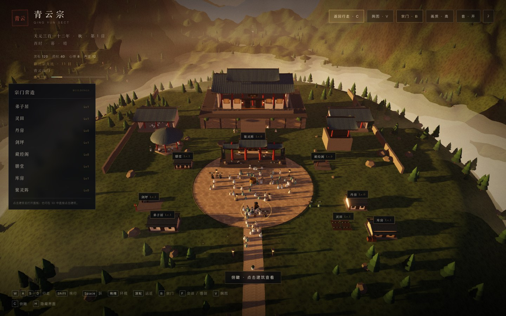
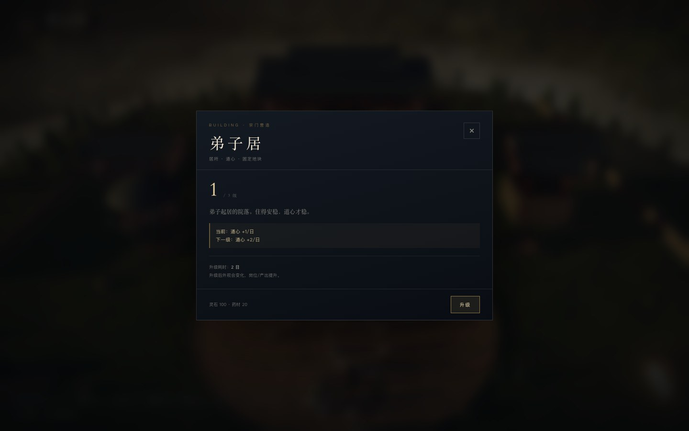
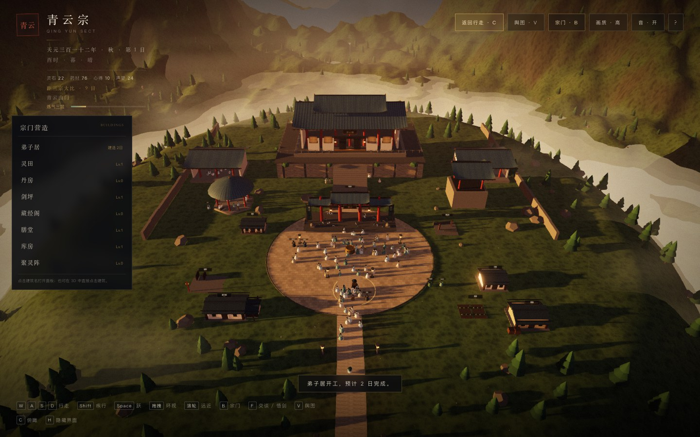
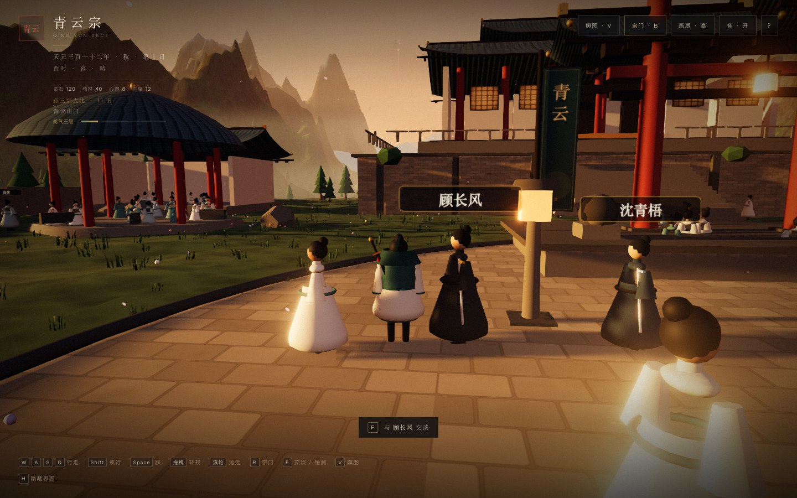

# 19 · G4 Phase B：看得见的宗门

> 这一版先解决“宗门实体”和“镜头”：8 栋建筑、3 级外观、俯瞰模式、建筑面板、施工与日常产出。
> 还没有做自由模式、事件候选、三条人物弧线——那是 P1/P2。

---

## 19.1 八栋建筑

| 建筑 | 初始 | 效果 | 位置 |
|------|------|------|------|
| 弟子居 | Lv.1 | 道心 +1/日，逐级 +1 | 西侧 |
| 灵田 | Lv.1 | 药材 +2/日，逐级 +2 | 东侧 |
| 丹房 | Lv.0 | 炼丹省药材 3/6/9 | 东侧 |
| 剑坪 | Lv.1 | 打坐修为 +1/2/3 | 西侧 |
| 藏经阁 | Lv.0 | 心得 +1/2/3 每日 | 东侧 |
| 膳堂 | Lv.1 | 道心 +1/2/3 每日 | 西侧 |
| 库房 | Lv.1 | 灵石 +1/2/3 每日 | 东南 |
| 聚灵阵 | Lv.0 | 掌门修炼 +2/4/6 每日 | 主殿前 |

- 全部是 **固定地块**，有碰撞体，玩家不能穿墙。
- 初始有些是 Lv.0 废墟/空地；需要修建。
- 每栋 **3 级外观**：茅棚/小院 → 加建/重檐 → 二层/塔楼/大阵。
- 建筑升级会改变模型；建造中显示脚手架。

---

## 19.2 建造与产出

建筑面板：

- 点击建筑 / 俯瞰列表 / 3D 标记 → 打开面板。
- 面板显示：
  - 当前等级与效果；
  - 下一级效果；
  - 升级消耗、耗时；
  - 施工剩余天数。
- 升级：
  - 扣资源；
  - 进入施工；
  - 结束今日推进 1 日；
  - 完成后等级 +1、模型重建。
- 每日产出在结束今日时结算：
  - 灵田药材、藏经阁心得、库房灵石、膳堂/弟子居道心、聚灵阵修为。
- 丹房减少炼丹药材消耗；剑坪提升打坐修为。

---

## 19.3 俯瞰模式

按 `C` 或点 HUD「俯瞰」：

- 相机升到山门上方，显示完整宗门。
- 左侧「宗门营造」列表：8 栋建筑、等级/施工天数。
- 3D 建筑头顶有 **DOM 标记**：名称 + Lv/施工。
- 点击列表或标记打开建筑面板。
- `C` / `Esc` 返回行走。
- 俯瞰不是实时战略，只是观察/点击；时间继续。

---

## 19.4 镜头与碰撞（P0）

- 默认远第三人称：相机距离约 10.8m，俯角 0.3。
- 相机遇到建筑/地形/树会拉近；太近时隐藏玩家模型。
- 极端遮挡时相机移到玩家前方，避免看到后脑勺/剑穿模。
- 玩家与七名具名弟子有动态碰撞；群像被推开，建筑地块周围清场。
- 具名弟子与建筑都有碰撞体；玩家不再穿过人和墙。

> 这是“可接受”的第一版，不是完美：极端贴墙时画面会变成墙/地面特写，后续需要更细的相机探测。

---

## 19.5 与存档/旧系统的整合

- `GameState.buildings` 保存等级与施工天数。
- 旧档自动补默认建筑等级。
- 载入后重建所有建筑模型、标记、碰撞体。
- 建筑产出进入每日结算与报告。
- 与宗门簿、场景、修炼、斗法共存。

---

## 19.6 实测

| 项 | 结果 |
|----|------|
| 8 栋建筑 | ✅ 全部出现在地图/俯瞰 |
| 3 级模型 | ✅ 重建并显示等级 |
| 建造 | ✅ 扣资源、施工、结束今日推进 |
| 每日产出 | ✅ 灵田/藏经阁/库房/膳堂/弟子居/聚灵阵 |
| 建筑面板 | ✅ 等级/效果/成本/施工 |
| 俯瞰列表 | ✅ 8 项，点击开面板 |
| DOM 标记 | ✅ 名称 + Lv/施工，可点击 |
| 玩家/弟子碰撞 | ✅ 0.94m 停止 |
| 群像清场 | ✅ 建筑/弟子周围推开 |
| 镜头遮挡 | ✅ 拉近/隐藏玩家/前置相机 |
| 存档 | ✅ 等级/施工恢复 |
| 控制台错误 | 0 |

**性能**

- 山门 draw calls **273-279**（休眠，8 栋建筑 + DOM 标记；已移除建筑 Sprite 标签）。
- 俯瞰 **310**（视锥裁剪后）。
- JS **821 KB / 223 KB gzip**。

---

## 19.7 已知限制

- 建筑模型仍是程序化低多边形，不是最终美术；3 级差异以体量/屋顶/围栏为主。
- 没有自由摆放/旋转，只有固定地块。
- 建筑没有室内；点击是面板，不是进门。
- 没有岗位分配/工匠/建造队列，只有单栋施工。
- 建筑效果是每日简单产出，未与弟子岗位深度绑定。
- 俯瞰没有拖拽平移/缩放，只有固定高机位。
- 极端贴墙时相机会变成墙/地面特写。
- 建筑标签用 DOM 投影，未做遮挡淡化。
- 还没有自由模式/候选事件/人物弧线。

---

## 19.8 下一阶段（P1）

1. 通关后自由修行，不再 12 天结束。
2. 行动点：打坐/交谈/场景/炼丹自由组合。
3. 建筑岗位与弟子派工。
4. 季节/维护费/周报。
5. 候选事件 3 选 1。
