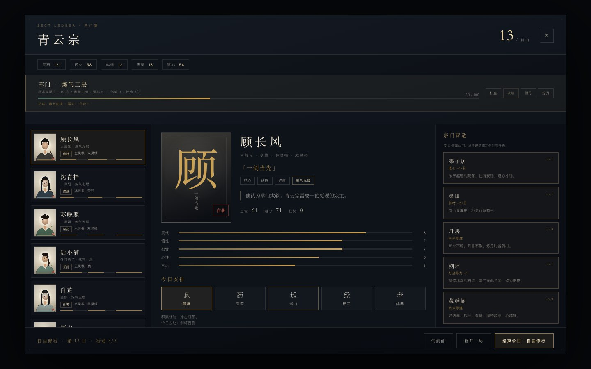
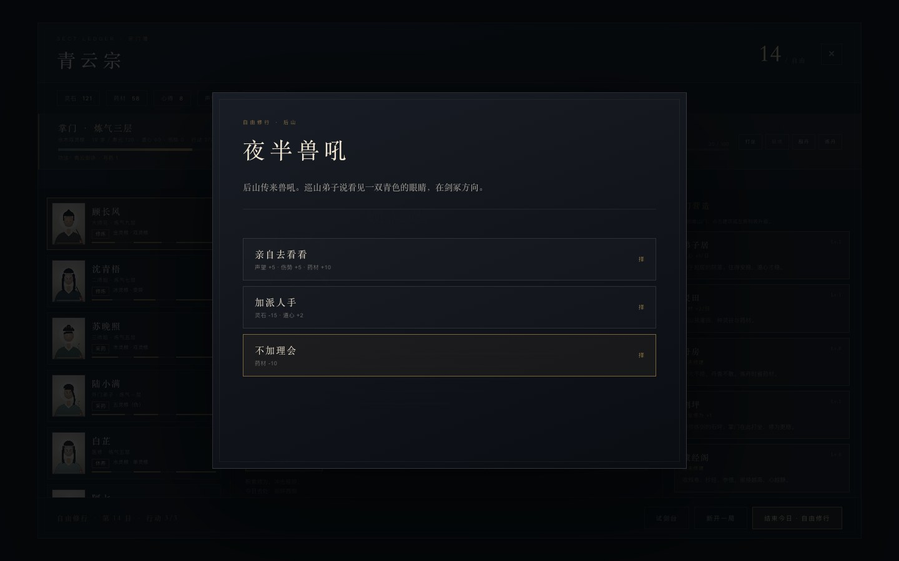

# 20 · G4 P1：自由修行与行动点

> 通关后不再“本章已终”。十二日大比只是序章的结束，之后进入自由修行。
> 每日 3 点行动，打坐/炼丹/交谈/外出要自己分配。

---

## 20.1 怎么进入自由修行

1. 完成第十二日三宗大比。
2. 结局弹窗出现。
3. 点 **「留在山门」**。
4. 时间推进到第 13 日，宗门进入自由修行：
   - 标题变为「第 13 / 自由」；
   - 底部按钮变为「结束今日 · 自由修行」；
   - 不再触发大比；
   - 每天随机出现一个自由事件。

「再开一局」仍然重置到第一日。

---

## 20.2 行动点

每日 **3 点行动**，在 HUD、宗门簿掌门条、底部目标中显示。

| 行动 | 消耗 | 说明 |
|------|------|------|
| 打坐 | 1 | 修为 +；每日一次 |
| 炼丹 | 1 | 丹药 +1；每日一次；丹房减药材 |
| 交谈 | 1 | 闲聊/指点/问心事；每日最多 2 人 |
| 场景动作 | 1 | 悟剑/采药/赶集；每日每场景一次 |
| 破境 | 0 | 不占行动 |
| 服丹 | 0 | 不占行动 |
| 建筑升级 | 0 | 不占行动 |
| 旅行 | 0 | 不占行动 |
| 试剑台 | 0 | 不占行动 |

- 行动点耗尽后，打坐/炼丹/交谈/场景动作都会被拒绝。
- 结束今日恢复 3 点。
- 宗门簿按钮会按行动点置灰。

---

## 20.3 自由事件

自由修行每天从 6 个事件中随机抽取 1 个：

- 游方散修
- 灵田抽穗
- 夜半兽吼
- 小宗来访
- 弟子梦魇
- 连雨

每个事件 2-3 个选项，有资源、道心、声望、关系等后果。
事件不进入主线计数，可重复出现。

---

## 20.4 自由修行还能做什么

- 继续安排七名弟子。
- 继续升级 8 栋建筑。
- 继续打坐/炼丹/破境/渡劫。
- 去剑冢/药圃/坊市。
- 试剑台。
- 保存/载入/导出/导入。
- 不再有第 12 日硬结束。

---

## 20.5 存档

新增字段：

- `freeMode: boolean`
- `actionPoints: number`

旧档自动补：

- `freeMode = false`
- `actionPoints = 3`

自由修行中保存，载入后仍在第 13 日或之后，行动点恢复为保存值（0-3）。

---

## 20.6 实测

| 项 | 结果 |
|----|------|
| 结局「留在山门」 | ✅ 进入第 13 日 |
| 大比后不再结束 | ✅ |
| 每日 3 行动点 | ✅ |
| 打坐/交谈/场景扣点 | ✅ |
| 0 点时拒绝行动 | ✅ |
| 结束今日恢复 3 点 | ✅ |
| 自由事件抽取 | ✅ 夜半兽吼等 |
| 自由事件选项 | ✅ |
| 宗门簿显示 8 栋建筑 | ✅ |
| 存档/载入自由模式 | ✅ |
| 控制台错误 | 0 |

---

## 20.7 已知限制

- 自由事件只有 6 个，还没有长链/人物弧线。
- 没有季节/年/年龄推进。
- 没有行动点与建筑岗位的联动。
- 没有“跳过全部事件”的代价机制。
- 自由事件不消耗行动点，只在结束今日时触发。
- 自由修行仍是同一座山门，没有新区域。
- 还没有三条人物弧线（P2）和角色美术（P3）。

---

## 20.8 下一步 P2

- 沈青梧 · 灭门线。
- 顾长风 · 夺权线。
- 陆小满 · 天灵根线。
- 每条 3-4 个场景，选择有延迟后果。
