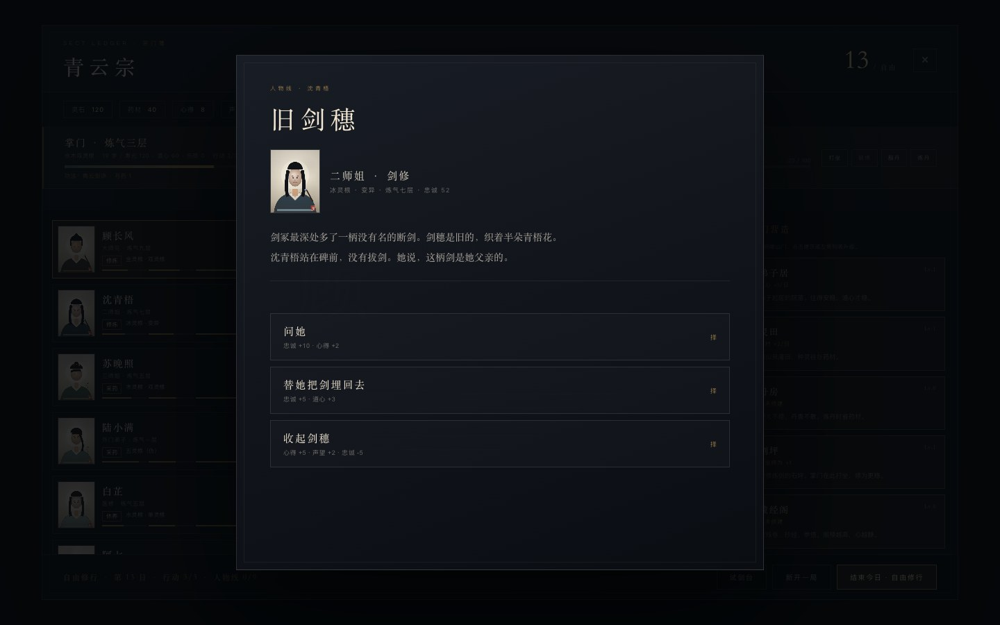
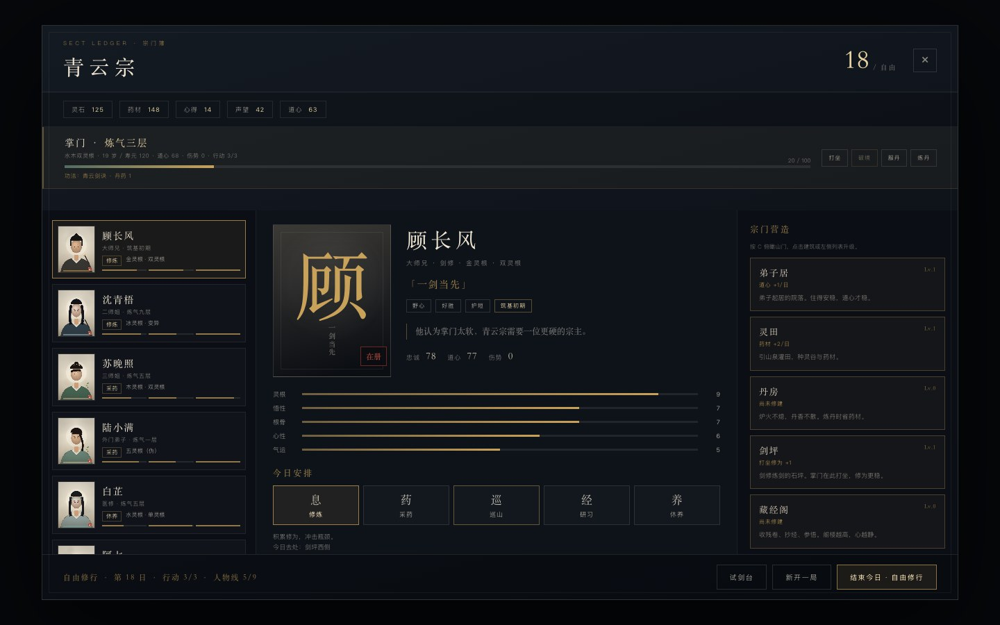

# 21 · G4 P2：三条人物弧线

> 自由修行不再只有随机小事。  
> 沈青梧、顾长风、陆小满各有一条 3 场景人物线，选择有延迟后果。

---

## 21.1 触发方式

- 完成十二日大比，点「留在山门」。
- 自由修行每天结束今日时：
  1. 先检查 **人物线** 是否有下一幕；
  2. 有则触发人物线；
  3. 没有才抽随机自由事件。
- 三条线共 **9 幕**；做完 9 幕触发终章「宗门志」。
- 每天只推进一幕，玩家可以慢慢玩。

宗门簿底部显示：`人物线 x/9`。

---

## 21.2 沈青梧 · 灭门线

**主题：她留在青云宗，是为了看你和上一代宗主有什么不同。**

| 幕 | 事件 | 关键选择 |
|----|------|----------|
| 1 | 旧剑穗 | 问她 / 替她埋剑 / 收起剑穗 |
| 2 | 夜访 | 让她自己决定 / 扣下斗笠人 / 赶走斗笠人 |
| 3 | 剑冢问心 | 替上一代道歉 / 让她走 / 收走两柄剑 |

后果：

- 信任够，她留下，成为剑冢的守剑人。
- 让她走，`沈青梧` 离开，名册变为「已离开」。
- 收走两柄剑，她留下，但 `shenResent`，不再拔旧剑。
- 终章会根据 `shenStay` / `shenGone` / `shenResent` 给出不同旁白。

---

## 21.3 顾长风 · 夺权线

**主题：他想要副宗主的位置，不是为了钱，是为了证明自己。**

| 幕 | 事件 | 关键选择 |
|----|------|----------|
| 1 | 大比之后 | 给副宗主 / 当众拒绝 / 试剑定输赢 |
| 2 | 私会 | 把话摊开 / 当众查他 / 给灵石让他自己断 |
| 3 | 山门之夜 | 把印留给他 / 让他下山 / 收印留人 |

后果：

- 留印：顾长风成为副宗主，终章「主殿的灯终于有人分担」。
- 让他下山：`gu` 离开，名册「已离开」。
- 收印留人：他留下，但 `guDemoted`，不再进主殿。
- 试剑选项需要至少一场试剑胜场。

---

## 21.4 陆小满 · 天灵根线

**主题：一个被大宗盯上的孩子，最后自己选去哪里。**

| 幕 | 事件 | 关键选择 |
|----|------|----------|
| 1 | 灵根觉醒 | 封锁消息 / 让他自己说 / 昭告山下 |
| 2 | 大宗来使 | 回绝 / 谈条件 / 让他去 |
| 3 | 去留 | 留下 / 去天剑宗 / 让他自己选 |

后果：

- 留下：`luStay`，终章「天灵根终于长在自己的山里」。
- 去天剑宗：`lu` 离开，山门少一个背药篓的影子。
- 谈条件：灵石 +80，但陆小满忠诚 -5。
- 让他去（第 2 幕）会直接结束该线，`luArc=3`。

---

## 21.5 终章「宗门志」

9 幕全部结束后，下一次结束今日触发：

**《宗门志》**

- 合上宗门志：道心 +5、声望 +3。
- 翻到下一页：灵石 +50、道心 +2。

选择后 `arcFinale=true`，三条线的结局旁白写入宗门日志；之后继续自由事件。

---

## 21.6 实测

| 项 | 结果 |
|----|------|
| 9 幕按顺序触发 | ✅ 第 14-22 日 |
| 人物线进度 | ✅ 5/9、9/9 |
| 选择改变忠诚/旗标 | ✅ |
| 沈青梧离开 | ✅ active=false，存档恢复 |
| 顾长风离开 | ✅ |
| 陆小满离开 | ✅ |
| 终章触发 | ✅ 第 23 日 |
| 终章旁白写入日志 | ✅ |
| 控制台错误 | 0 |

---

## 21.7 已知限制

- 全部是文字 + 立绘，没有配音/过场/3D 演出。
- 三条线固定顺序，不能跳过或并行选择。
- 只在自由修行触发；12 日章节内不出现。
- 离开的弟子不会补位，也没有后续信件。
- 终章是静态文本，不改写大比结局评分。
- 没有多结局分支图；只有旗标/旁白差异。

---

## 21.8 下一步 P3

- 统一低多边形角色比例/剪影。
- 七名弟子差异：衣领、发式、配饰、披风/面纱/胡须。
- 群像也加衣领/腰带/面部。
- 不做骨骼/布料/口型，避免继续假装 3A。
