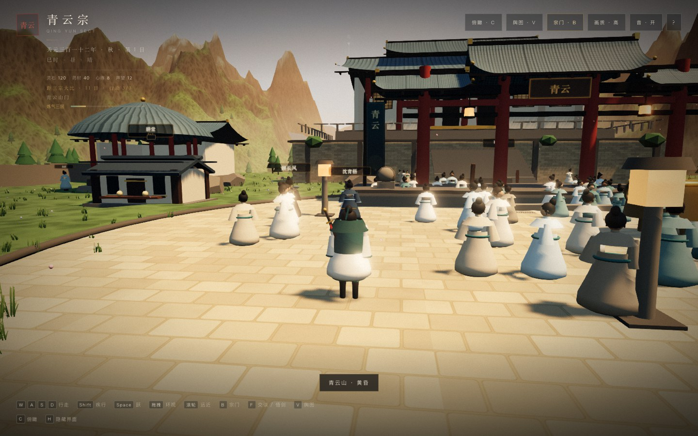
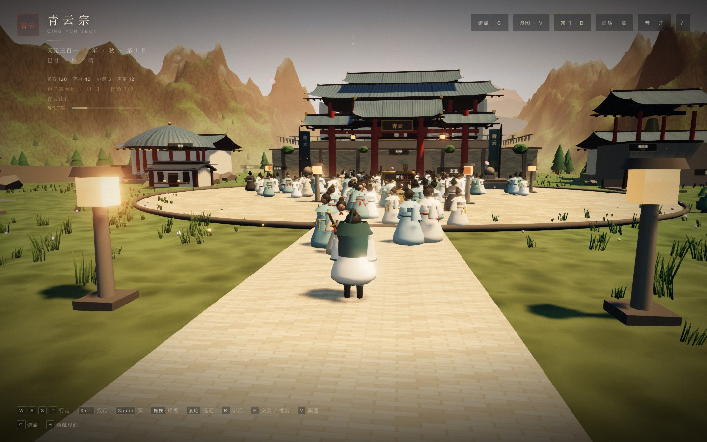

# 22 · G4 P3：低多边形美术统一

> 目标不是 3A，而是“看起来是同一款游戏”。  
> 统一比例、剪影、衣领、腰带、袖口、面部和七人差异。

---

## 22.1 方向

- 保留低多边形/水墨色块，不追写实面数。
- 先修 **剪影**：
  - 头身比；
  - 肩宽；
  - 下摆；
  - 袖口；
  - 发髻。
- 再加 **识别点**：
  - 顾长风：护肩、披风、剑。
  - 沈青梧：剑、发簪、冷色衣领。
  - 苏晚照：药篓、药草。
  - 陆小满：短身量、药篓。
  - 白芷：面纱、药箱。
  - 阿七：酒葫芦、短打。
  - 玄真：长杖、白须。

---

## 22.2 具名弟子

- 新增 **衣领**：V 字交领。
- 新增 **腰带/腰结**。
- 新增 **袖口/下摆滚边**。
- 新增 **前襟两条长带**。
- 新增 **发簪**。
- 新增 **眼睛/眉/鼻/嘴**（几何，不贴图）。
- 新增 **护肩/披风/面纱/白须/药篓/酒葫芦**。
- 七个角色仍是 **一人一个合并 mesh**，没有增加 draw call。

---

## 22.3 群像

- 群像使用同一套改进后的模型：
  - 更宽的下摆；
  - 交领；
  - 腰带；
  - 袖口；
  - 发髻。
- 新增 **trim InstancedMesh**：200 条腰带/衣领，染成金/红/青/灰。
- 新增 **face InstancedMesh**：眼睛/眉/嘴。
- 群像从 4 个 InstancedMesh 变成 **6 个**，draw calls +2。

---

## 22.4 玩家

- 玩家模型原本已有：
  - 内外袍；
  - 交领；
  - 腰带；
  - 护腕；
  - 发髻/发带/发簪；
  - 面部；
  - 剑鞘/拔剑。
- 本阶段只统一色板和比例，没有重做。

---

## 22.5 性能

| 项 | 结果 |
|----|------|
| 具名弟子 | 7 个合并 mesh |
| 群像 | 6 个 InstancedMesh |
| 山门 draw calls | **273-279**（休眠） / **324**（试剑） |
| 控制台错误 | 0 |

JS **845 KB / 231 KB gzip**。

---

## 22.6 已知限制

- 没有骨骼、手臂摆动、布料、口型、表情。
- 群像面部是几何点，不是贴图。
- 衣摆仍可能和腿/剑轻微穿插。
- 没有 LOD；远处群像仍是完整几何。
- 这是“统一风格的低多边形”，不是 3A 角色。

---

## 22.7 结论

到这一版为止：

- 8 栋建筑有实体、等级、施工；
- 自由修行有行动点、6 个随机事件；
- 三条人物线共 9 幕 + 终章；
- 七名弟子和群像有统一剪影/衣领/腰带/面部；
- 穿模、镜头、碰撞做过一轮修整；
- 存档/载入覆盖建筑、自由模式、人物线旗标。

这是一款 **可玩的垂直切片**，不是商业级完整游戏。
