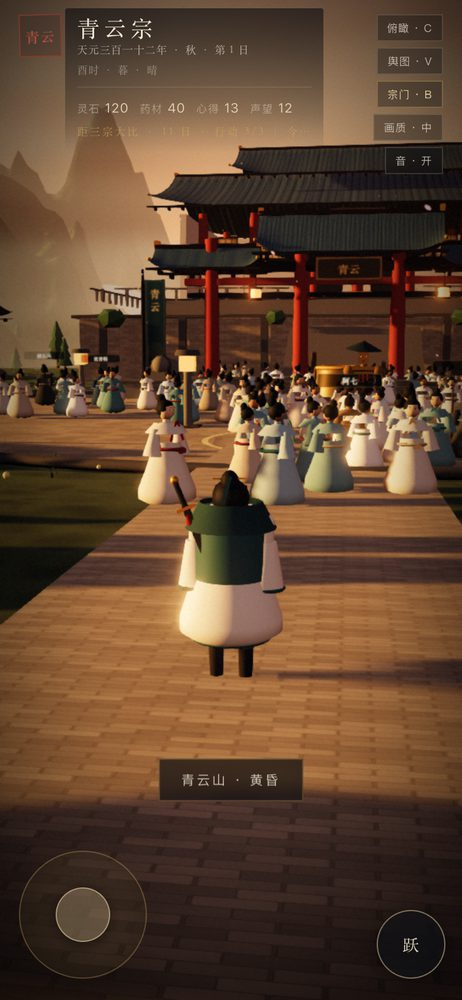
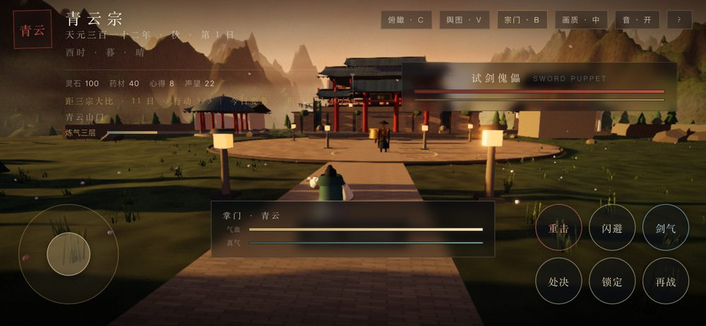
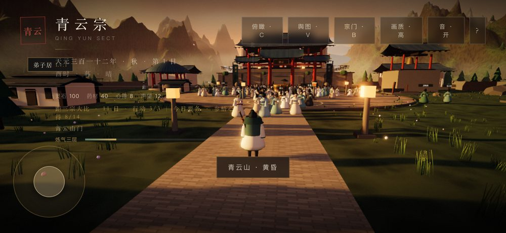
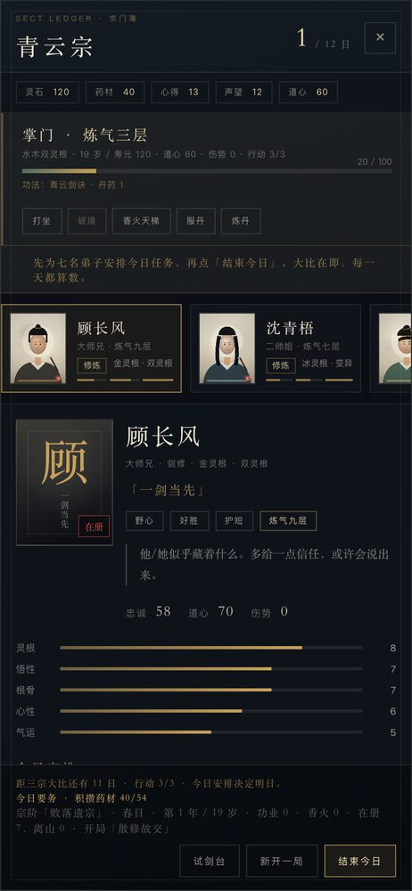
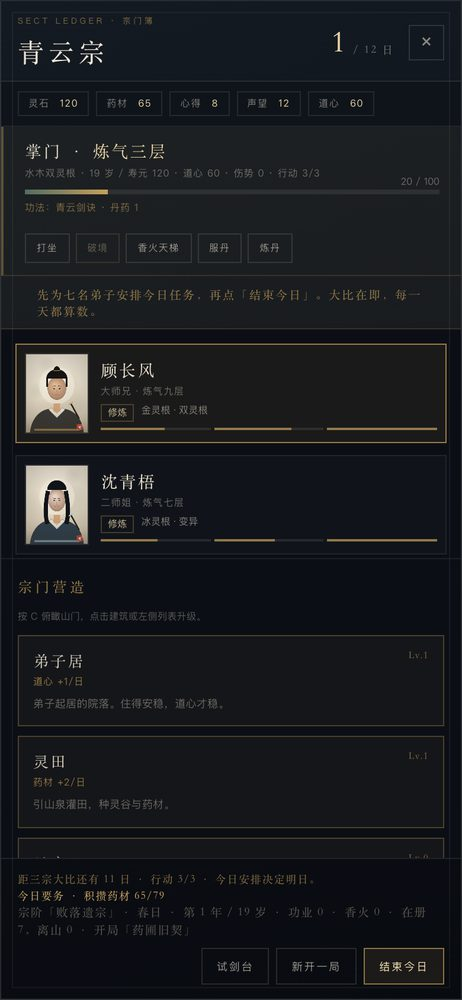
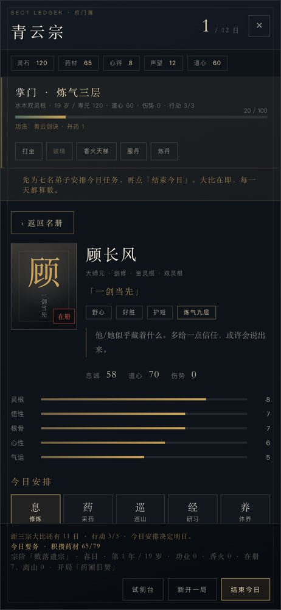

# 37 · 手机端适配（虚拟摇杆 + 触屏交互）

> 手机没有 WASD。本辑给移动端一套完整的触屏方案：左摇杆行走、右屏拖拽环视、双指缩放、上下文交互/跳跃/战斗按钮，并压缩 HUD 让竖屏也可玩。桌面键鼠完全不受影响。

---

## 37.0 实机截图

竖屏（左摇杆 + 跳跃键；顶栏带底衬；罗盘隐藏避免压到面板）：

战斗 · 竖屏（顶栏收起，敌我血条分置上下，3×2 技能网格不与摇杆冲突）：

横屏（推荐；顶栏保留但收紧）：

---

## 37.1 操控映射

| 桌面 | 触屏 |
|---|---|
| WASD / 方向键 行走 | 左下虚拟摇杆（模拟量，轻推慢走、推到底疾行） |
| 拖拽 环视 | 右半屏单指拖拽 |
| 滚轮 远近 | 双指捏合缩放 |
| Shift 疾行 | 摇杆推到底 |
| Space 跃 | 右侧「跃」按钮 |
| F 交谈 / 交互 | 靠近时出现的上下文按钮（自动读取 NPC / 场景动作名） |
| 左键 剑 · 右键 重击 | 点屏幕 = 轻击；「重击」按钮 |
| Q 闪避 · E 剑气 · F 处决 · Tab 锁定 · R 再战 | 战斗时出现的六个圆形按钮 |

## 37.2 实现要点

- `src/core/input.ts`：新增虚拟输入面——`setVirtualMove/getVirtualMove`（模拟摇杆轴）、`pressVirtual/releaseVirtual/tapVirtual`（虚拟按键）、`injectClick`（注入轻/重击）、`addWheel`（捏合→缩放），并暴露 `input.touch` 粗指针判定。**核心逻辑仍然只认 `Input`，游戏主体无感知。**
- `src/core/touch.ts`（新）：`TouchControls` 仅在 `input.touch` 为真时挂载；渲染摇杆与按钮，双指 `touchstart/move/end` 处理捏合；竖屏窄屏显示可关闭的「横屏体验更佳」提示（6 秒自动消失）。
- `src/characters/player.ts`：摇杆有输入时以模拟量驱动前/右，推到底自动疾行。
- `src/main.ts`：抽出 `tryInteract()`，键盘 F 与触屏交互按钮共用；战斗按钮直连 `combat.handleKey()`；每帧同步交互/战斗按钮显隐与 UI 阻塞态。
- `src/style.css`：canvas `touch-action:none`；`.touch-ui` 摇杆/按钮样式；隐藏按钮改用 `display:none` 不占位；窄屏/触屏压缩 HUD（顶栏半透明底、省略长文本、隐藏桌面按键提示）。

## 37.2b 第三轮：宗门簿面板重排（0.28.2）

手机打开「宗门簿」时有三处错位，均已修复：

| 问题 | 修法 |
|---|---|
| 头像块固定 `170px`，而手机栅格列只有 `120px` → 头像压住「顾长风」与属性文字 | 头像列与方块一起收到 `92×120`，栅格 `92px + 1fr`，字号同步下调 |
| 弟子列表横向卡片 `min-width:210px`，与下方详情互相挤叠 | 列表改为 `flex: 0 0 auto` 的横向滚动 + `scroll-snap`，卡片 `150px`，详情独立成块 |
| 面板 `height:100vh` 在移动浏览器被地址栏裁掉底部按钮 | 改用 `100dvh`（并保留 `100vh` 兜底）；头部/资源条/底栏全部压缩内边距 |

另外：

- 「建筑 / 日志」在手机上原本被 `display:none` 直接隐藏，导致手机无法升级建筑 → 改为排在弟子详情下方（单列网格），功能不再缺失。
- 「横屏体验更佳」提示原先会压在面板底部的「结束今日」上 → 打开任意面板时自动隐藏（`is-suppressed`）。

几何自动化断言（新增进冒烟）：头像右边界 < 姓名左边界、面板高度 ≤ 视口高、无横向溢出、侧栏可见。

## 37.2c 竖屏宗门簿：名册 ⇄ 详情 两级导航（0.29.0）

竖屏宽度不足以并排「名册 + 详情」，改成移动端常见的两级流：

| 名册（进入面板的默认视图） | 详情（点任意弟子后） |
|---|---|
|  |  |

- 名册：弟子卡竖排、整行可点（一屏约 4 人），下方接「宗门营造」与日志；
- 详情：占满内容区、可独立滚动（分配任务 / 传法 / 关系都在同一屏），顶部有「‹ 返回名册」；
- 每次打开面板都回到名册，避免「上次停在谁身上」的困惑；
- 横屏与桌面完全不受影响（列表 + 详情仍并排/三栏）。

实现：`setNarrowDetail()` 在 `.sect-sheet` 上切 `is-narrow-detail`，窄屏竖屏媒体查询里只显示其中一栏；返回按钮 `[data-back]` 走同一套事件委托。

## 37.3 已修复的坑

- 隐藏的战斗按钮原本仍占布局高度（`.is-hidden` 只改透明度），把「跃」按钮挤出屏幕 → 改为 `display:none`。
- 摇杆 `setPointerCapture` 在合成事件下抛错会中断处理 → 包 `try/catch` 并把定位放到捕获之前。
- 竖屏顶栏文字与场景重叠 → 加半透明底 + 单行省略。
- 战斗六键竖排高达 422px，横屏手机只有 390px 高 → 改为 3×2 网格（120px 高），战斗时隐藏「跃」键腾位。
- 触屏 DPR 常为 3，渲染压力过大 → 引擎在粗指针设备把像素比上限压到 1.4，首次运行默认画质取「中」。
- **第二轮重叠修整**（本轮）：
  - 提示条 `.toast` 在底部压住摇杆 → 触屏抬到 168px，且允许换行（`white-space: normal`）防横向溢出；战斗时改到顶部 84px。
  - 顶栏「北」罗盘压在面板底衬上 → 窄屏触屏隐藏罗盘。
  - 触屏底栏（键盘提示已隐藏）仍留 52px 内边距压住摇杆 → `padding:0`。
  - 战斗 HUD 与摇杆/技能网格互相遮挡 → 触屏战斗隐藏顶栏，敌方卡贴顶、掌门卡抬到 172px、连击/处决上移。
  - 已用几何检测脚本在 390×844 / 844×390 / 360×640 / 1024×768 四尺寸、探索与战斗两状态下验证：**非父子元素重叠数 = 0，越界元素 = 0**。

## 37.4 验收

- 冒烟回归 **54 项**（新增 3 项：触屏 UI 挂载、摇杆轴前向/复位、移动端零报错）；
- 横竖屏实测：摇杆、跳跃、六个战斗键全部落在可视区内；
- 桌面 51 项原样通过，说明键鼠行为未变；
- 版本 0.23.0。
