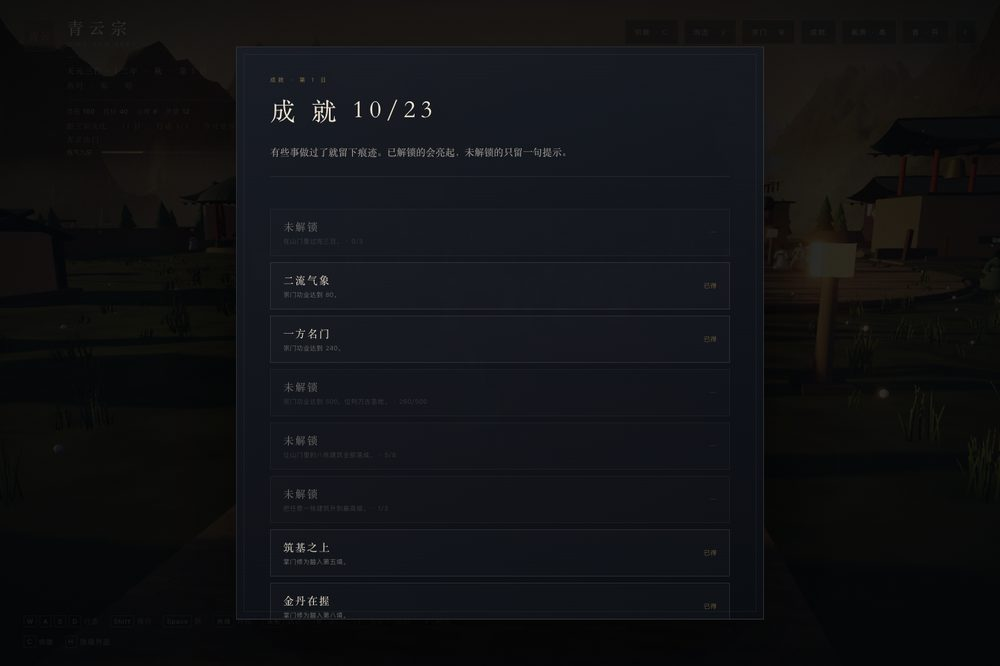
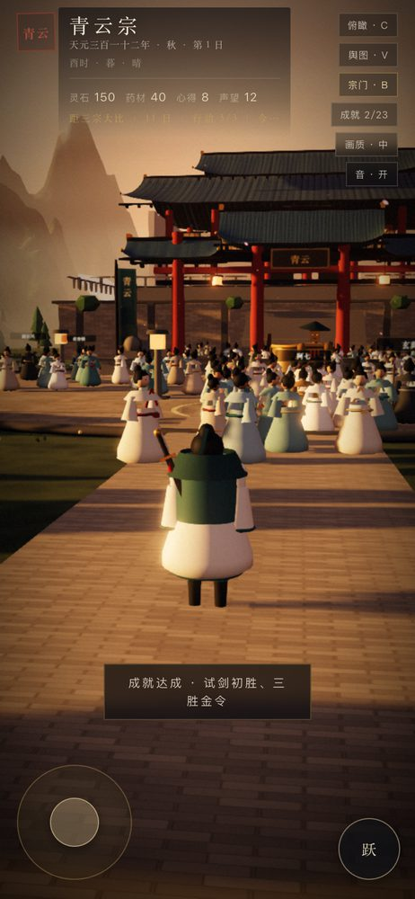

# 39 · 成就系统与手感打磨（让它更像一个「成品游戏」）

> 这一轮补的是「完成度」：可收集的成就、触屏震动与按压反馈、以及设置项。冒烟回归 60 → 62 项。

---

## 39.0 实机截图

手机端（HUD 直接显示 `成就 x/23`，解锁提示自动换行）：

---

## 39.1 成就系统（23 项）

`src/game/achievements.ts` 定义 23 条纯谓词成就，覆盖六条线：

| 线 | 成就 |
|---|---|
| 经营 | 山中三日、二流气象(80)、一方名门(240)、万古圣地(500)、八栋齐全、匠心独运(建筑满级) |
| 修行 | 筑基之上(5)、金丹在握(8)、此界尽头(10)、渡劫客 |
| 斗法 | 试剑初胜、三胜金令 |
| 叙事 | 一诺既定(1 条弧线)、七人同心(7 条)、破煞(魔道)、六纪(6 段时代)、尘埃落定(第一章)、三宗魁首 |
| 收集 | 得一至宝、四宝齐备、香火初用、传法 |
| 元 | 再入轮回(二周目) |

- 状态存 `state.achievements: string[]`，随存档持久、旧档由 `normalizeState` 补齐；
- `Game.save()` 前调用 `unlockPending()`：命中即写入并回调 `onUnlock(ids)`，由外壳弹 toast + 短震动，**不递归存档**；
- 面板从 HUD 的「成就」chip 打开，未解锁显示提示与进度（如 `260/500`），已解锁显示名字与「已得」；
- 为让「渡劫」「章节结局」可判定，补了两个 flag：`flags.tribWins`、`flags.chapterRank`。

## 39.2 手感与设置

- **触感反馈**：`haptic(ms)`（`navigator.vibrate`），只在触屏设备且设置开启时生效。触发点：日结、战斗胜/负、成就解锁、切换触感开关；
- **按压反馈**：触屏下 `.chip/.sect-btn/.gift-btn/.assign-btn/.teach-btn/.story-option` 按下时 `scale(0.96) + brightness(1.25)`；
- **设置项**：`GameSettings` 新增 `haptics`，标题与暂停面板各加一个「触感 · 开/关」按钮（`touch-only`：桌面不显示）。

## 39.3 排障记录（重要）

调试时发现成就面板「DOM 有内容但看不见」。逐层排查（className、祖先 opacity、遍历全部 CSS 规则含媒体查询）后确认：

- 无任何规则设置 `opacity: 0`，元素也没有内联样式；
- 但 `getAnimations()` 显示 transition 停在 `currentTime = 0`；
- **延迟 2 秒后再测，opacity 变为 1**。

结论：这是 **headless + SwiftShader 下合成器帧率极低导致 CSS transition 迟迟不推进**的测试环境假象，真实浏览器无此问题（同一机制下的宗门簿一直正常）。**因此没有改代码**，只把截图流程的等待时间加长。这条记在这里，避免下次又被误判成 bug 去「修」。

## 39.4 界面收口（0.26.0 追加）

- **HUD「成就 x/23」**：chip 直接显示收集进度，集满变「成就 ✓」；
- **日期转场卡**：日结时中央浮现「第 N 日 / 晨」，1.7 秒淡出，给「过了一天」一个明确的节拍；
- **标题页 DEMO 标识**：`IMMORTAL SECT · CHAPTER I · DEMO`，与 README 的定位一致。

## 39.5 验收

- 冒烟 **63 项**：新增「成就随状态解锁并持久化」「成就面板 23 行且标记已解锁」「日期卡存在并可播放」；
- 面板实测：`成就 10/23`，已解锁高亮、未解锁带进度；
- 版本 0.26.0。
