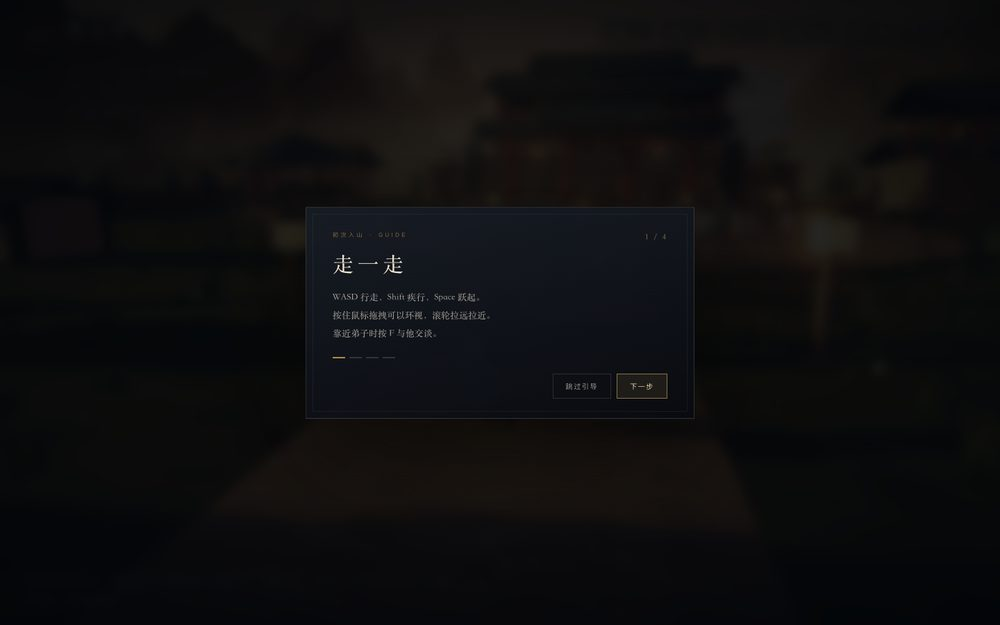

# 40 · 新手引导、自动存档提示与标题演出

> 继续往「成品」靠：第一次进游戏有人带你走一遍；每次自动存档有回执；标题页有进场节奏。冒烟回归 63 → 65 项。

---

## 40.0 实机截图

---

## 40.1 新手引导（首次进入，4 步，可跳过）

`src/ui/tutorial.ts` 一个独立覆盖层，四步讲清核心循环：

1. **走一走** —— 移动/视角/交谈（触屏则为摇杆/拖拽/捏合）；
2. **看今天要做什么** —— 今日要务与行动点；
3. **打开宗门簿** —— 弟子安排 / 建筑 / 日志；
4. **去剑坪试试身手** —— 斗法与三胜得法宝。

细节：

- 触屏与键鼠**各写一套文案**（`input.touch` 决定）；
- 底部进度点 + 「下一步 / 开始经营」，随时「跳过引导」；
- 打开期间游戏暂停（计入 `uiBlocking`），`Esc / Enter / Space` 也能结束；
- 完成或跳过后写 `flags.tutorialDone` 并存档，此后不再打扰；
- **`?demo=1` 不触发**，避免影响演示链接与自动化回归。

## 40.2 自动存档回执

- `Game.save()` 末尾触发 `onSaved`，外壳做了 **1.6 秒节流**后让 HUD 右下角闪一下「已保存」；
- 触屏上位置上移到操作区之上，不压摇杆；
- 存档本来就是每次操作都写 localStorage，这个提示只是把「已经存好了」变成看得见的事。

## 40.3 标题页进场

- 标题卡片的 7 个子元素以 0.1 秒间隔错峰浮入（`titleRise`），返场时重新触发；
- 与 `DEMO` 标识一起，让首屏更像「有开场」而不是静态菜单。

## 40.4 装进手机（PWA-lite）

- 新增 `manifest.webmanifest`（standalone、主题色、192/512 图标，含 maskable），
  配 `apple-touch-icon` 与 `apple-mobile-web-app-*`，手机上「添加到主屏幕」后是全屏无地址栏的独立窗口；
- 新增 `og-image.jpg` 与 OG / Twitter 卡片 meta，仓库链接分享出去会显示标题与配图；
- 没有引入 Service Worker —— 避免缓存失效带来「更新了却还是旧版」的经典坑，离线缓存留给以后。

## 40.5 验收

- 冒烟 **65 项**：新增「引导层存在且初始隐藏」「存档提示元素存在」；
- 端到端实测：4 步走完 → 覆盖层隐藏、`flags.tutorialDone === true`、**已写入 localStorage**；打坐后 HUD 出现「已保存」；
- 版本 0.28.0；`dist/` 现含 favicon / apple-touch-icon / icon-192 / icon-512 / manifest / og-image。
