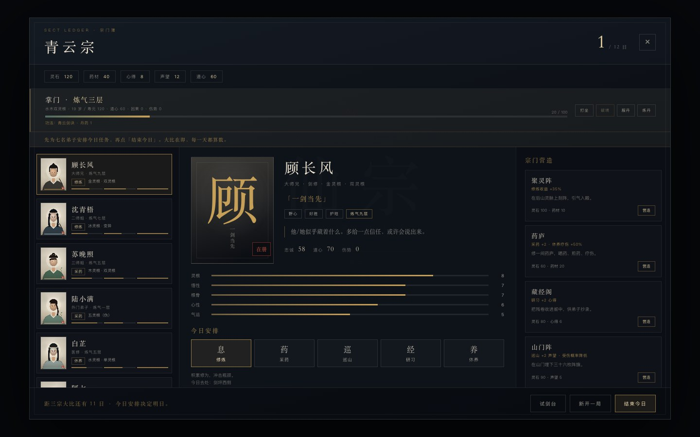
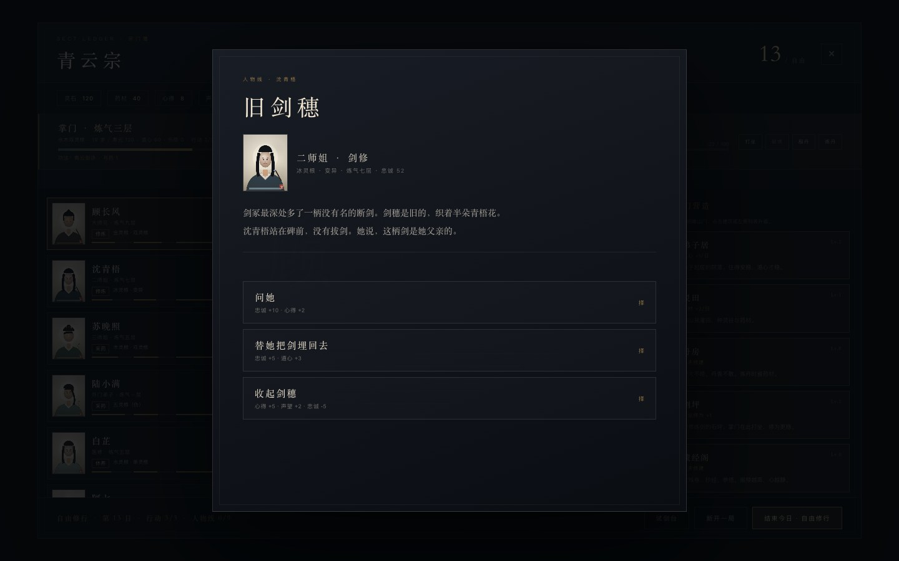
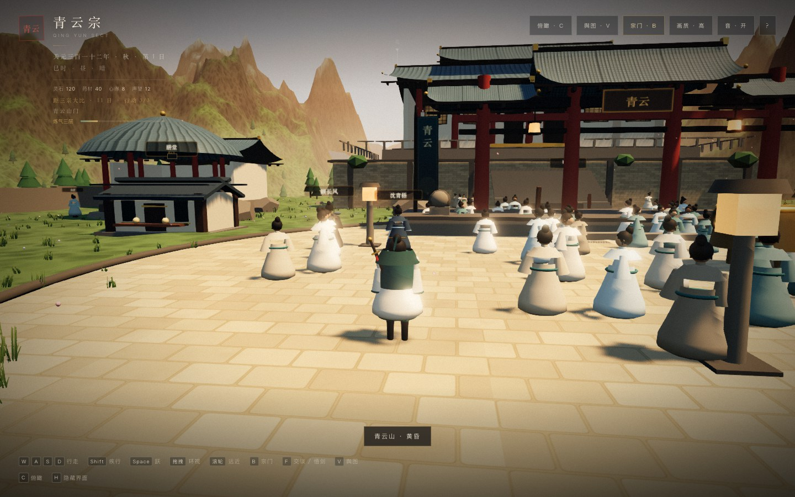
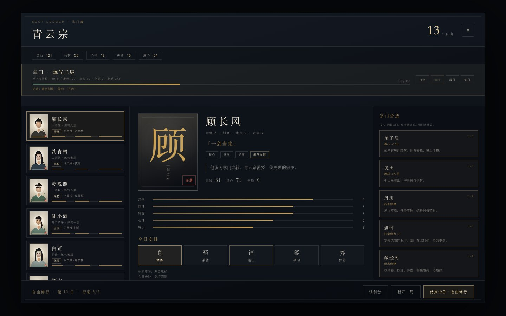
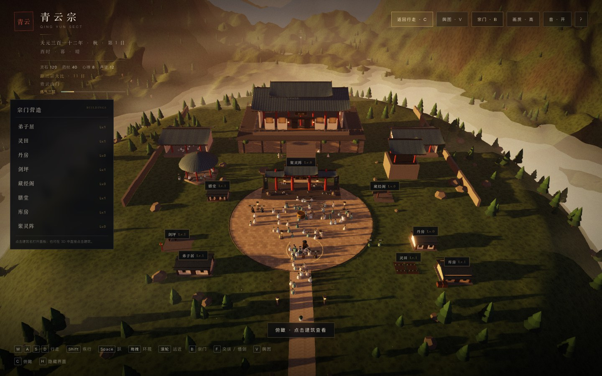

# 青云山门 · G4 P2/P3 · 人物线 + 美术统一

> 《仙宗》浏览器端原型：标题/暂停/自动档+3手动槽，青云山门、后山剑冢、灵田药圃、山门坊市，七名可交谈弟子，以及能破境、渡劫的掌门修炼。
> **这是 G3 垂直切片，不是成品。** 美术为程序化占位，季节循环/宗门战争/3D 天劫尚未接入。



---

## 运行

要求：Node.js ≥ 20。

```bash
cd prototype
node serve.mjs
# http://127.0.0.1:4175
```

开发：

```bash
pnpm install
pnpm dev
pnpm build
```

---

## 操作

| 输入 | 动作 |
|------|------|
| `WASD` | 行走 |
| `Shift` | 疾行 |
| `Space` | 跳跃 |
| 拖拽 / 滚轮 | 环视 / 远近 |
| `B` | 宗门簿 |
| `V` | 舆图（剑冢/药圃/坊市/山门） |
| `C` | 俯瞰 / 返回行走 |
| `F` | 与弟子交谈 / 场景交互（战斗中为处决） |
| `Esc` | 暂停 / 关闭面板 |
| `左键` | 三段剑（战斗） |
| `右键` | 重击（25 真气） |
| `Q` | 闪避 |
| `E` | 剑气（30 真气） |
| `Tab` | 锁定 |
| `1-4` | 晨/午/暮/夜 |
| `M` | 静音 |
| `H` | 隐藏界面 |
| `F1` | 性能 |

---

## 常规游戏外壳

- **标题菜单**：继续 / 新的旅程 / 载入存档 / 画质 / 音。
- **暂停菜单**：继续 / 保存 / 载入 / 回到标题 / 画质 / 音。
- **自动存档 + 3 个手动槽**。
- 元数据：第几日、章节、保存时间、游戏时长、在册人数、是否通关。
- 手动保存、覆盖确认、删除、导出 JSON、导入 JSON。
- 设置持久化；旧版单存档自动迁移到自动档。
- 载入后同步 3D 区域、七名弟子位置、宗门簿与 HUD。

> 详见 `docs/15-save-load.md`。

---

## 三场景（`V` 舆图）

| 场景 | 唯一动作 | 收益 |
|------|----------|------|
| 后山剑冢 | 悟剑 | 心得 +4、修为 +6、习得「霜刃」 |
| 灵田药圃 | 采药 | 药材 +18（药庐 +6） |
| 山门坊市 | 赶集 | 买药/卖药/买丹/打听，每日一次 |

- 旅行 2 小时；场景动作 4 小时；每日一次。
- 离开山门时群像与七名弟子隐藏，返回恢复。
- 区域写入存档，刷新后回到该区域出生点。
- 山门 draw calls ~273-279；试剑 ~324。

> 详见 `docs/16-regions.md`。

---

## 掌门修炼

- 初始：炼气三层、修为 20/100、水木双灵根、真气 120、青云剑诀、1 枚丹药、道心 60。
- 宗门簿顶部掌门条：
  - **打坐**：每日一次，修为 +9 + 道心/20 - 伤势/20（悟剑后 +2）。
  - **炼丹**：药材 20 → 丹药 1，每日一次。
  - **服丹**：丹药 -1 → 修为 +12。
  - **破境**：气海满 100 后可用。
- 破境三选一：稳守 / 以剑引雷 / 服丹护体。
- 下一境界为筑基时进入 **天劫**。
- 成功：境界 +1、真气上限 +10、寿元 +5。
- 失败：修为 55、道心 -6、伤势 +18；天劫额外寿元 -8。
- 道心受剧情选择影响。

> 详见 `docs/17-cultivation.md`。

---

## G4 P2：三条人物线

- 沈青梧 · 灭门线（3 幕）
- 顾长风 · 夺权线（3 幕）
- 陆小满 · 天灵根线（3 幕）
- 自由修行每天触发一幕；9 幕完成触发「宗门志」。
- 选择会改变忠诚/去留/旗标，终章日志不同。



---

## G4 P3：低多边形美术

- 具名弟子：衣领、腰带、袖口、下摆、发簪、眼睛/眉/鼻/嘴。
- 七人差异：护肩/披风、药篓、面纱、白须、酒葫芦、长杖。
- 群像：6 个 InstancedMesh，新增衣领/腰带/面部。
- 不是 3A；统一剪影与色板。



---

## G4 P1：自由修行

- 十二日大比后点「留在山门」进入第 13 日。
- 每日 3 行动点：打坐/炼丹/交谈/场景动作各 1 点。
- 结束今日恢复 3 点。
- 6 个自由事件随机抽取。
- 8 栋建筑继续升级；宗门簿右侧显示建筑等级。



---

## G4 Phase B：8 栋建筑

- 弟子居、灵田、丹房、剑坪、藏经阁、膳堂、库房、聚灵阵。
- 固定地块，全部有碰撞体。
- 每栋 3 级外观；Lv.0 是废墟/空地。
- 点击建筑/俯瞰列表/DOM 标记打开面板。
- 升级消耗资源，施工 1-4 日，结束今日推进；完成后换模型。
- 每日产出：药材/心得/灵石/道心/修为；丹房省药材，剑坪加打坐。
- 按 `C` 俯瞰，左侧列表显示 8 栋等级/施工。



---

## 宗门经营：第一章《残山剩水》

- 12 日：为七名弟子安排修炼/采药/巡山/研习/休养，结束今日。
- 七名弟子：顾长风、沈青梧、苏晚照、陆小满、白芷、阿七、玄真。
- 序章 + 6 主事件 + 5 个人事件 + 3 随机事件 + 4 结局。
- 四种营造、赠礼、温养、试剑。
- 试剑胜利：声望 +4、灵石 +20、评分加成。

---

## 七名弟子进入 3D

- 按安排出现在剑坪/药圃/石阶/东殿/西亭。
- 名札、靠近提示、`F` 交谈。
- 每日每人一次、全宗门两次有收益交谈。
- 闲聊/指点/问心事；心事写入存档。
- 战斗开始退场，结束归位。

---

## 斗法：试剑傀儡

- 靠近试剑台 9.5m 自动锁定。
- 三段剑 → 重击压架势 → 剑气 → 闪避红环 → 架势破 → `F` 处决。
- 7 状态 AI；顿帧、震屏、刀光、火花、伤害数字、程序化音效。

---

## 技术结构

```
src/
├── core/        # 渲染 / 输入 / 音频 / 噪声 / 贴图
├── world/
│   ├── regions.ts    # 剑冢/药圃/坊市：合批几何、局部光、动作点
│   ├── terrain.ts    # 高度/坡度
│   ├── sect.ts       # 山门建筑
│   └── ...
├── characters/
│   ├── character.ts  # 掌门 / NPC 基础几何
│   ├── player.ts     # 玩家控制 / 锁定镜头 / 真气上限
│   ├── npcs.ts       # 200 群像
│   └── named.ts      # 七名具名弟子
├── combat/      # 战斗流程 / 傀儡 AI / HUD / VFX
├── game/
│   ├── state.ts       # 存档结构、弟子、事件、掌门修炼
│   ├── game.ts        # 日循环、事件、区域、修炼、破境、评分
│   ├── saves.ts       # v2 存档槽、迁移、导出/导入
│   ├── scenes.ts      # 区域定义
│   ├── dialogue.ts    # 角色台词/心事
│   └── portraits.ts   # 程序化水墨立绘
├── ui/
│   ├── hud.ts         # HUD / 世界提示 / 境界条
│   ├── game-ui.ts     # 宗门簿 / 事件 / 交谈 / 破境
│   ├── menu-ui.ts     # 标题 / 暂停 / 存档槽
│   └── region-ui.ts   # 舆图
├── main.ts
└── style.css
```

---

## 实测（M3 / 1440×900 / 画质高）

| 指标 | 山门 | 场景 |
|------|------|------|
| Draw calls | ~350 | 273-295 |
| 三角面 | 0.82 M | — |
| 群像 | 200 + 7 具名 | 0 |
| 斗法 | 324 calls / 0.33 M | — |
| JS（gzip） | 215 KB | 同 |
| 冷启动 | 11-12 s | 同 |
| 山门 draw calls | 372（含建筑/群像） | 俯瞰 310 |

**验收**：标题/暂停/自动档+3槽、导出导入、旧档迁移、舆图旅行、三场景动作、每日限制、区域存档、打坐/炼丹/服丹/破境/天劫、七人隐藏/恢复、12 日章节，全部通过，0 控制台错误。

---

## 已知限制

- 场景是同一地形上的口袋区域，不是独立关卡/室内；旅行即时。
- 每个场景只有一个主要交互。
- 掌门修炼只有 12 日章节；没有季节/年龄增长/寿尽结局。
- 功法只影响破境，不影响战斗技能；因果值未参与判定。
- 天劫是一次文本判定，不是 3D Boss 战。
- 七名弟子没有骨骼、手臂动作、口型；已有动态碰撞。
- 立绘为程序化水墨，辨识度有限。
- 山门 350 draw calls，高于 300 目标；冷启动 11-12s。
- 仅 WebGL2；WebGPU 未接入。

---

## 调试参数

| 参数 | 作用 |
|------|------|
| `?demo=1` | 自动开始 |
| `?fresh=1` | 清空当前自动档并新开（手动槽保留） |
| `?story=0` | 跳过序章 |
| `?panel=1` | 直接打开宗门簿 |
| `?intro=0` | 跳过开场运镜 |
| `?fight=1` | 传送到试剑台并开战 |
| `?shot=1` | 电影机位 + 隐藏 UI |
| `?t=17.35` | 指定时间 |
| `?perf=1` | 性能面板 |
| `?auto=0` | 关闭自动降画质 |

`window.__sect` 暴露 `player / combat / game / gameUi / named / regions / regionUI / engine / disciples / sect / sky / input`。

---

## 下一步

1. 天劫 3D 战。
2. 建筑岗位/派工/维护费。
3. 更多事件/季节。
4. 骨骼/布料/口型（正式美术资产）。
5. 山门 draw calls 压回 300。
